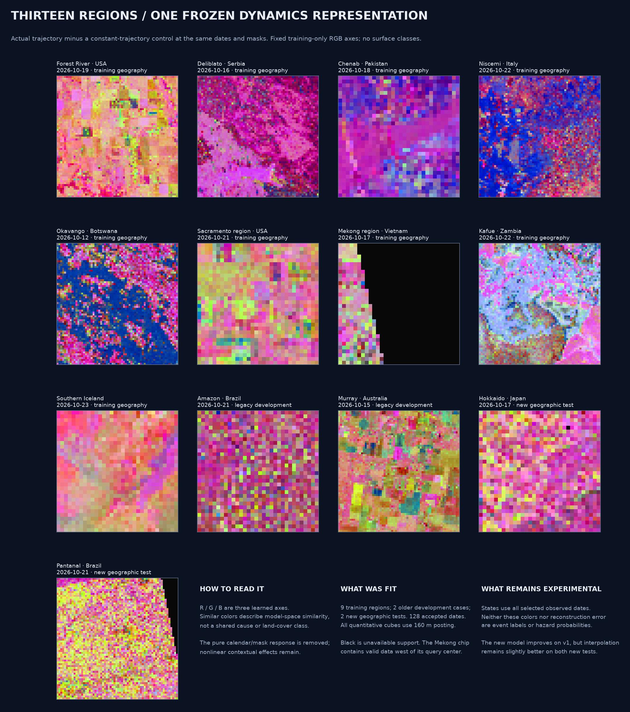
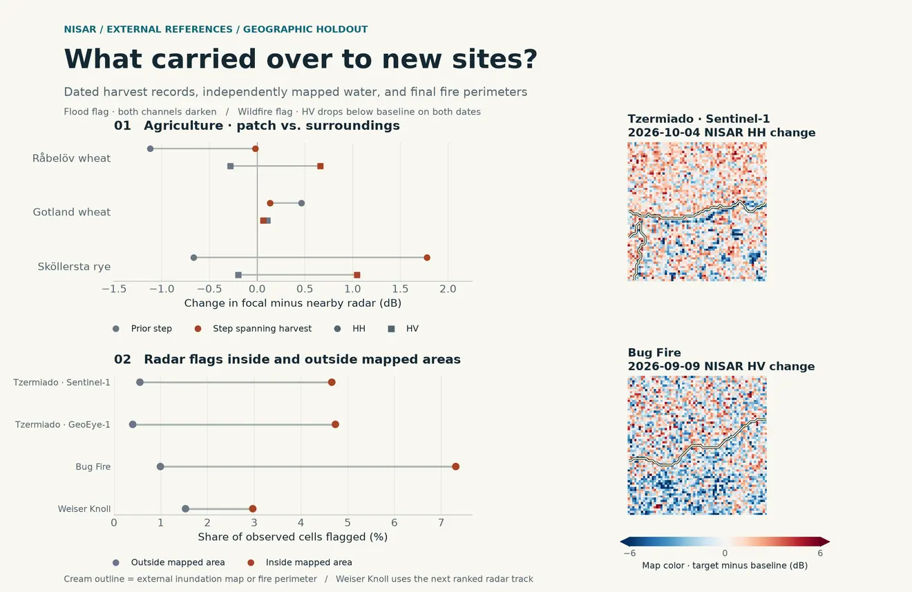
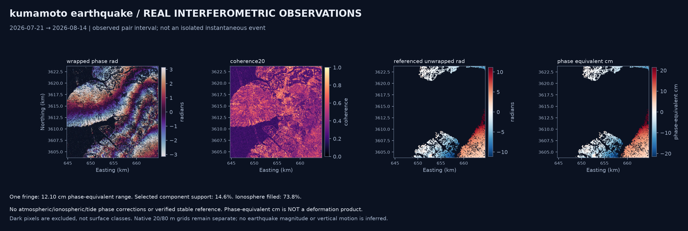

# NISAR Surface Dynamics

Explore how Earth's surfaces change through measured radar time series and interferometry. This is the **science and data-processing backend** for an educational exploration project: agriculture, wildfires, floods, landslides, wetlands, earthquakes and more.

**Observed dynamics · worldwide point queries · explicit quality flags · no forecasting**



[Team integration guide](TEAM_HANDOFF.md) · [V2 modeling and InSAR results](docs/MODELING_V2.md) · [V2 model card](models/global_explorer_v2/MODEL_CARD.md) · [Download measured examples](https://github.com/Ch0comilo/NISAR-Modeling/releases/tag/v0.5.0)

## Exploration lenses

Pick a point and date window to see what NISAR measured there. Start with the time series and signed dB maps, then apply a lens to ask a more specific question of the same observations. The backend keeps the measured change, its historical baseline and any independent evidence separate so people can investigate their own questions and see where the observations leave room for interpretation.

| Lens | Question you can ask | Measured example |
| --- | --- | --- |
| `flood_wetland` | Where did both radar channels darken, and how does that line up with independently observed water? | On two snapshots of the same Crete flood, both channels darkened in 4.7% of mapped inundation cells versus 0.4–0.6% nearby. Most mapped cells went unflagged. |
| `vegetation_disturbance` | How does radar change where dated optical data show vegetation loss, compared with baseline-matched cells? | At the Timber Fire site, optical data showed loss in 157 of 256 usable cells. The 13 matched pairs left the radar contrast uncertain in both channels. |
| `wildfire` | Where did the cross-polarized signal stay below its earlier range across multiple observations? | Repeated HV declines at the Bug Fire appeared in 7.3% of cells inside the mapped perimeter and 1.0% nearby. The perimeter gives event context and can enclose unburned areas. |
| `agriculture` | Did a focal patch change differently from the surrounding landscape? | At the Sköllersta rye trial, the focal-minus-nearby HH contrast rose 1.78 dB between radar dates bracketing the recorded harvest. The trial record supplies a date and point. |



The API publishes partial and insufficient-data outcomes. For an automatically selected radar series with zero usable pixels, it tries at most one compatible alternate. At Weiser Knoll the first series yielded no usable pixels across five dates and the alternate yielded five usable observations. Each result reports its selected series and both attempts when a retry runs.

Run the loopback API with the installed package and local Earthdata access. List the lenses with `GET /v1/lenses` and send a point request to `POST /v1/explore`. Poll the returned `status_url` to get the observations, comparison and GeoTIFF links.

```powershell
.venv\Scripts\python.exe -m surface_dynamics serve-explore --cache scratch/explore-cache
```

In another terminal, submit one of the measured examples:

```powershell
$cases = Get-Content contracts/examples/exploration-lens-requests.json -Raw | ConvertFrom-Json
$body = $cases.skollersta_agriculture | ConvertTo-Json -Depth 5
Invoke-RestMethod http://127.0.0.1:8787/v1/explore -Method Post -ContentType application/json -Body $body
```

[Lens methods and interpretation](docs/EXPLORATION_LENSES.md) · [Point API and response fields](docs/EXPLORE_API.md) · [Geographic holdouts and cell counts](docs/EXPLORATION_HOLDOUT.md)

## Flood evidence in new regions

The [held-out Pursat experiment](docs/FLOOD_SIMILARITY.md) scores resemblance to earlier flood observations and retrieves example radar histories. The score separated new water from stable nonwater in this chip. Existing open water often scored just as highly.

The [fresh flood evaluation](docs/FLOOD_EVIDENCE.md) connects observed HH/HV changes with dated OPERA optical-water transitions. Three sites in Senegal and India met the evaluation gates out of 16 screened. The baseline departure flagged **17.8%** of strict new-water reference cells at Matam and **87.5%** at Barh, where it also flagged **32.6%** of stable open water. Reports include acquisition curves, signed dB layers, optical transitions, agreement maps and spatially resampled contrasts. The [output contract](docs/FLOOD_EVIDENCE.md#teammate-output-contract) describes the artifacts and coverage statuses.

## New exploration: measurable features and departures from baseline

The [surface-feature report](docs/SURFACE_FEATURES.md) compares **3,764 measured histories in 21 scenes** with their own observed baselines. It shows raw/standardized HH and HV change, observed departure counts, polarization balance and local spatial contrast. Independent optical water groups and real measured curves expose both useful differences and overlap. A separate **3,380-history** experiment compares physical, learned and combined cross-region analogs after matching actual acquisition sampling.

The new `fingerprint` worker accepts worldwide catalog point/date requests or measured local cubes and exports checksummed feature maps and point summaries. See its [input/output contract](docs/SURFACE_FEATURES.md#reusable-worldwide-inputoutput-contract). Diagnostic departures are not verified normality or phenomenon classes. **91 offline tests pass.**

## New exploration: 2D maps of the frozen representations

The [UMAP atlas](docs/REPRESENTATION_UMAP.md) projects **3,764 measured HH/HV histories across 21 existing scene windows** into 2D, plus a separate **1,388-history change map**. Clickable standalone plots connect each point to its measured radar history. Original-space density groups, representative examples, physical-descriptor comparisons and declared sensitivity runs show both shared behavior and strong scene/sampling dependence. The encoder is unchanged; groups are exploratory, with no event-class validation. **75 offline tests pass.**

Install `.[exploration]`, restore the existing release fixtures, then run `scripts/explore_representations.py` and `scripts/verify_representation_umap.py`. Complete plots, vectors, histories and provenance are generated under `products/representation_umap`; the [exploration report](docs/REPRESENTATION_UMAP.md) describes their contracts and limits.

## Current release: v0.5.0

The new **shared characterization report** answers what changed, when it was observed, how its trajectory behaved, which independent evidence is usable and which alternative explanations remain. It exports fixed-support trajectories, physical summaries, observed-pattern maps, linked spectra/GP results and explicit evidence states under one teammate contract. Five new measured scenes add **42 GCOV acquisitions**; eight shared reports, four fresh flood-policy comparisons and two new InSAR jobs have **291 independently checked artifacts**.

The new validation finds important limits: cloud/timing gaps prevent new-water recall estimates at the two fresh flood-context sites, and an embedding kNN probe produces severe nonwater false flags in the Australian control. The frozen Transformer is unchanged and is not promoted to phenomenon labeling. The first independent optical vegetation-disturbance adapter and a new Venezuela earthquake-context stack retain explicit attribution/correction gates. **70 offline tests pass.**

[V0.5 scientific results](docs/CHARACTERIZATION_V05.md) · [Shared input/output contract](docs/CHARACTERIZATION_V05_CONTRACTS.md) · [Validation report](docs/CHARACTERIZATION_V05_VALIDATION.md)

## Previous release: v0.4.0

The new **evidence-linked flood characterization** worker describes real radar changes, compares independent optical-water observations, selects controls from baseline radar measurements and returns observed timing, trajectories, radar-signature objects and explanations linked to data artifacts. Three real development scenes use 21 NISAR acquisitions. New-water reference cells in Pakistan show a **-4.93 dB matched mean contrast**, while existing water also triggers the darkening rule; baseline sensitivity is exposed rather than hidden. Mozambique and Indiana remain partial because of cloud, timing and acquisition limits. These are observed signatures and optical-product agreement, not validated flood extent or global classification accuracy.

The new **InSAR correction-readiness audit** finds only **3 common eligible correction-input cells** in the wider Kumamoto window, despite 1,614 common coherent phase cells. It publishes the missing reference/correction gates and keeps LOS displacement null. Version 0.4 adds four schemas, **59 offline tests**, and **33 independently checked new artifacts** across five jobs. The frozen global Transformer remains unchanged.

Start with the [scientific report](docs/FLOOD_CHARACTERIZATION.md), [validation and caveats](docs/FLOOD_VALIDATION.md) and [teammate contract](docs/CHARACTERIZATION_CONTRACTS.md).

## Frozen global representation: v0.3 experiment

The new candidate uses **visible-only normalization and an interpolation-residual Transformer**, trained on nine regions with broader seasonal support. Thirteen regions across six continents provide **128 accepted regional acquisition chips** at a common 160 m posting; Hokkaido and Pantanal are two newly reserved geographic tests. Raw contextual states and a **constant-trajectory control contrast** are separate outputs, so calendar-induced latent evolution is distinguishable from trajectory-related representation changes.

On the new geographic tests, V2 reconstruction RMSE is **0.661 dB in Hokkaido** and **0.561 dB in Pantanal**, improving over V1's 0.785 and 0.588 dB on the same data/support. Interpolation remains slightly better at 0.652 and 0.560 dB; the temporal mean or Matérn GP can also win. The learned views remain experimental. The [full protocol and results](docs/MODELING_V2.md) distinguish these new tests from the older Amazon/Murray development cases.

New **multi-pair InSAR** processing compares three actual Kumamoto intervals, exports coherence contrasts and gates phase comparison on a shared reference. The 5 km window lacks common phase support; a separate 15 km window has 4.57%. Neither establishes stable ground or validated displacement. The release adds ten request/result schemas, point-query quality/probe outcomes, **43 offline tests**, and independent verification of **298 artifacts across 15 new jobs**.

## What you can explore

| Module | Implemented methods | Results for an exploration app |
|---|---|---|
| Measured surface change | Gamma0 power, robust dispersion, actual-date slopes and steps, spatial texture, POD | Georeferenced layers, trajectories, transition rates, modes and measured-date animations |
| Shared characterization **new** | Fixed common populations, observed trajectory patterns, evidence states and linked method outputs | One traceable report of what changed, observed timing, spatial behavior and alternative explanations |
| Flood characterization **new** | Fixed radar signatures, independent OPERA optical-water evidence, baseline-only matched controls, spatial bootstrap, observed timing | Support-aware comparisons, trajectories, radar-signature GeoJSON objects and evidence-linked explanations |
| Spectral structure | Actual-time generalized Lomb–Scargle, sampling-window diagnostics, permutation tests, local sinusoidal fits when supported | Candidate-period maps, spectra and time-frequency arrays |
| Stochastic states | Empirical-Bayes Matérn-3/2 Gaussian processes, Monte Carlo draws, spatial block bootstrap | Historical latent-state distributions and separate spatial-heterogeneity intervals |
| Shared learned representation | Masked temporal Transformers; 42,292-parameter v2 candidate; training-only projections | Per-date 48-dimensional states, constant-control contrasts, shared colors and dropout sensitivity |
| InSAR pair | Native wrapped/unwrapped grids, coherence, connected components and ionosphere flags | Phase/coherence maps, threshold sensitivity, supported-component statistics |
| InSAR intervals | Compatible measured pair stacks, common native pixels, coherent-component/reference gates | Interval coherence contrasts, phase support, shared-pixel radians when available and explicit partial outcomes |
| InSAR correction readiness **new** | Common component/fill/screen/uncertainty gates and threshold sensitivity | Explicit missing-input checklist and support layers; no correction or displacement claim |
| InSAR network **new** | Compatible acquisition graphs, connected components, minimum temporal-baseline forest, independent cycle paths | Available pair intervals, event bracketing and catalog-level time-series readiness |
| Map probe | Pixel or metric-radius extraction from an existing NetCDF | Measured histories, descriptors and contextual learned states for a map selection |

Themes supply questions and candidate physical explanations. They do not turn a radar change into a confirmed fire, flood or landslide label. Missing data and unsupported model domains have explicit results.

## Quick start

Python 3.11+; the CPU reference environment uses Python 3.13.5. From a fresh clone on Windows:

```powershell
git clone https://github.com/Ch0comilo/NISAR-Modeling.git
cd NISAR-Modeling
python -m venv .venv
.venv\Scripts\python.exe -m pip install torch==2.11.0 --index-url https://download.pytorch.org/whl/cpu
.venv\Scripts\python.exe -m pip install -e .
.venv\Scripts\python.exe -m unittest discover -s tests -v
```

On Linux, use `.venv/bin/python` in place of `.venv\Scripts\python.exe`. `requirements-lock.txt` records the exact reference CPU environment; install it after the CPU Torch step to reproduce those versions.

Restore the regional cubes and InSAR pairs from the checksummed release asset, then run an offline job:

```powershell
.venv\Scripts\python.exe scripts\download_examples.py
.venv\Scripts\python.exe -m surface_dynamics characterize contracts\examples\wheatbelt-characterization.json --output products\characterization_v05\runs\wheatbelt
.venv\Scripts\python.exe -m surface_dynamics flood-characterize contracts\examples\qadirabad-flood.json --output products\flood_pilot\runs\qadirabad
.venv\Scripts\python.exe -m surface_dynamics insar-readiness contracts\examples\kumamoto-readiness.json --output products\insar_readiness\kumamoto_wide
.venv\Scripts\python.exe -m surface_dynamics analyze contracts\examples\hokkaido-v2.json --output products\global_v2\runs\hokkaido
.venv\Scripts\python.exe -m surface_dynamics insar-stack contracts\examples\kumamoto-stack-offline-wide.json --output products\example_insar_stack
.venv\Scripts\python.exe -m surface_dynamics probe contracts\examples\hokkaido-v2-probe.json --output products\probes\hokkaido-v2.json
```

No Earthdata credentials are needed for these downloaded fixtures. The release ZIP also contains the source, wheel, model weights, provenance and offline examples. The helper verifies its checksum and restores only measured fixtures; it refuses to overwrite different existing measurements.

For a live worldwide point/date request:

```powershell
# Supply EARTHDATA_TOKEN through your local environment or secret manager.
.venv\Scripts\python.exe -m surface_dynamics analyze contracts\examples\global-v2.json --output products\runs\world-v2
.venv\Scripts\python.exe -m surface_dynamics insar-network contracts\examples\kumamoto-network.json --output products\networks\kumamoto
```

Public catalog and InSAR-network discovery need no login. Quantitative archive reads require Earthdata authentication. Never put credentials in JSON requests, source files or commits.

## Backend contracts

Use the versioned [JSON Schemas](contracts/) and [request/response examples](contracts/examples/). The [handoff](TEAM_HANDOFF.md) explains shapes, units, coordinate conventions, artifact roles and interpretation limits.

- **Inputs:** WGS84 longitude/latitude with a UTC date window, or measured linear-power cubes with named polarizations, masks and a projected metric grid. InSAR accepts a measured GUNW pair or a point/event-date query.
- **Outputs:** validated JSON manifests; COG maps; NetCDF scientific arrays; CSV trajectories; NPZ draws/latent states; scientific PNG/GIF previews; network topology and observability diagnostics.
- **Python entrypoints:** `engine.analyze`, `engine.analyze_insar`, `insar_stack.process_stack`, `network.plan_network`, `probe.probe`, `flood.process_flood`, `insar_readiness.process_readiness`.

The synchronous workers and CLI support batch processing. The [local exploration API](docs/EXPLORE_API.md) adds point coverage, progressive GCOV jobs, measured date-comparison TIFFs and native wrapped-phase and coherence measurements for a selected InSAR pair.

## V1 reference evidence and continuing limits

The v0.2 reference run used **66 measured GCOV chips from seven regions across six continents**, plus a live global-point job and a real Kumamoto earthquake GUNW pair. Its nine original jobs have 152 checked artifacts. CI runs without downloading satellite data. The table below is the earlier V1 experiment on its original posting/support; use the [V2 report](docs/MODELING_V2.md) for the new matched-grid comparison.

Worldwide querying and processing are implemented within chip, resource and measurement limits. Coverage is uneven, and these regional examples do **not** establish globally validated model accuracy.

The expanded frozen-checkpoint benchmark hides **every internal acquisition** in the two held-out regional cubes. All methods use the same scored pixel/channel support and actual observation times:

| Geographic holdout | Acquisitions hidden one at a time | Transformer RMSE | Visible temporal mean | Actual-time interpolation |
|---|---:|---:|---:|---:|
| Amazon, Brazil | 6 | 1.600 dB | 1.178 dB | 1.211 dB |
| Murray Basin, Australia | 14 | 3.637 dB | 3.007 dB | 2.254 dB |

The Transformer currently loses to both simple baselines on both regions. Keep its representations experimental. Temporal windows and sampled pixels are correlated; these are **two independent geographic cases**, not thousands. No tuning or retraining used this expanded holdout result. See the [full benchmark](docs/results/model_benchmark_all_dates.json).

InSAR reports **phase-equivalent centimetres**, with `los_displacement_cm: null`. Atmospheric/ionospheric corrections, a verified stable reference and a validated sign are not established. The actual Kumamoto catalog contains three separate compatible networks with **no redundant closure cycles**; catalog connectivity alone cannot verify unwrapping. The [ASF GUNW guide](https://nisar-docs.asf.alaska.edu/gunw/) documents the supplied phase/correction layers; the [MintPy workflow](https://mintpy.readthedocs.io/en/latest/) provides the reference context for future corrected time-series work.

The network planner also passed [eight live public-catalog point checks](docs/results/global_network_checks.json), returning 27 compatible networks and 211 unique day-pair edges. These checks discover available products; they do not download or validate eight phase stacks.



## Keep Git small

Git contains source, contracts, documentation, compact trained weights and selected previews. Raw chips, NetCDF/COG job outputs, caches, virtual environments and ZIP bundles stay outside Git. Download the measured fixtures from [Releases](https://github.com/Ch0comilo/NISAR-Modeling/releases), or regenerate outputs locally.

`python scripts/repository_audit.py` checks the tracked tree for forbidden data paths, oversized files and common credential structures. The total tracked-file budget is 10 MiB. A normal `.gitignore` change does not remove data already present in Git history; see [the data policy](docs/DATA_AND_GIT.md).

## Development

```powershell
.venv\Scripts\python.exe scripts\benchmark_global_model.py
.venv\Scripts\python.exe scripts\run_global_examples.py
.venv\Scripts\python.exe scripts\run_global_v2.py
.venv\Scripts\python.exe scripts\verify_global_v2.py
.venv\Scripts\python.exe scripts\run_flood_pilot.py
.venv\Scripts\python.exe scripts\run_insar_readiness.py
.venv\Scripts\python.exe scripts\verify_flood_pilot.py
.venv\Scripts\python.exe scripts\run_characterization_v05.py
.venv\Scripts\python.exe scripts\evaluate_characterization_v05.py
.venv\Scripts\python.exe scripts\run_insar_v05.py
.venv\Scripts\python.exe scripts\verify_characterization_v05.py
```

`train_global_example.py` retrains the experimental representation; it is separate from the frozen benchmark. The model's five training geographies and two holdouts are documented in its card. Future scientific work should prioritize independent geography/season validation, native NISAR support, coherent common reference support and correction provenance before stronger model or deformation claims.

## Deploy to Modal

Use Python 3.13, the version exercised on Windows and the Modal Debian slim CPU runtime. The Modal worker installs the existing science lock, CPU-only PyTorch and Rasterio's system runtime dependencies, and mounts the frozen v2 checkpoint and projection assets. The gateway image contains only the HTTP dependencies. Read [the API contract](docs/API.md) and [the operator runbook](docs/MODAL_RUNBOOK.md).

From the repository root, with the project Python environment active and Modal authenticated:

```powershell
python -m pip install -e ".[api]"
python -m pip install modal
python -m unittest discover -s tests
python scripts/download_examples.py
python scripts/prepare_api_cases.py --output scratch/api-seed/cases
python -m modal volume create --env main nisar-evidence-v2
python -m modal volume put --env main nisar-evidence-v2 scratch/api-seed/cases /
```

Use an unused staging directory for each precompute. Publish the new case bundle from verified fixtures. The generated assets live in Modal Volume, outside Git. Review the non-secret resource-name options in .env.example and make sure the configured Modal Secret contains EARTHDATA_TOKEN. On PowerShell, set PYTHONUTF8=1 in the shell if console encoding fails.

```powershell
python -m modal serve --env main modal_app.py
python scripts/smoke_api.py <serve-url> --live
python -m modal deploy --env main modal_app.py
python scripts/smoke_api.py <deployed-url> --live
```

Serve opens a temporary Modal URL with reload on code changes. Run the smoke command in a second terminal and stop serve when finished. The deployed URL is printed by deploy. The --live smoke option submits one catalog-only job and verifies deduplication. The frontend must opt into the new contract before setting its base URL.

Use the [hosted observation mock](https://ch0comilo--nisar-evidence-api.us-east.modal.run/mock) to try live catalog selection, lens comparisons, and the model in a browser. The [mock guide](scripts/observation-mock/README.md) also covers running measured fixtures from a checkout.
