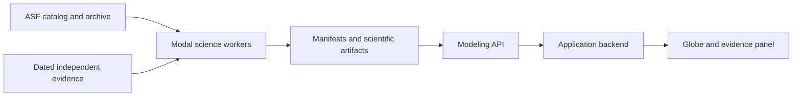

# NISAR Hazard Watch · Modeling

Explore how Earth's surface changes using measured NISAR radar time series and interferometry. This repository supplies the science workers and hosted API for the NISAR Hazard Watch NASA Space Apps project.

**Design goal.** Click anywhere on Earth, choose a question and date window, and get a traceable account of the available observations. Free exploration is the primary experience. Guided cases introduce the same evidence and limitations through precomputed artifacts. Where compatible acquisitions or usable pixels are missing, the result explains the gap.


[Integration handoff](TEAM_HANDOFF.md) · [API contract](docs/API.md) · [Live capabilities](https://ch0comilo--nisar-hazard-watch-ml.us-east.modal.run/v2/capabilities) · [Release fixtures and notes](https://github.com/nisar-hazard-watch/NISAR-Modeling/releases)

## What you can explore

**Verified** means supported by the linked tests or measured artifacts. **Experimental** means implemented with limited validation or weaker results than reference methods. **Prepared** means available as a local or branch artifact. **Planned** marks a design goal. A verified worker or case does not establish availability for every location.

| Capability | Status and what it tells you |
| --- | --- |
| Measured change and characterization | **Verified.** Compare gamma-zero histories, signed dB changes and spatial structure on documented support. Follow the evidence from acquisition to artifact. [Characterization](docs/CHARACTERIZATION_V05.md) |
| Flood and wetlands | **Verified diagnostic.** Read joint HH/HV darkening and compare with dated optical-water groups when usable. Stable water and other surfaces can also trigger the radar rule. [Flood evidence](docs/FLOOD_EVIDENCE.md) |
| Vegetation disturbance | **Verified diagnostic.** Compare polarization changes with earlier conditions and baseline-matched surroundings. Dated optical evidence can support a vegetation-loss interpretation. [Lens methods](docs/EXPLORATION_LENSES.md) |
| Wildfire | **Verified diagnostic.** Examine repeated HV departures and nearby controls. A mapped perimeter supplies event context, including potentially unburned areas. [Holdout results](docs/EXPLORATION_HOLDOUT.md) |
| Agriculture | **Verified diagnostic.** Compare focal and nearby returns and bracket a possible change using observed dates. A farm record can corroborate timing. [Agriculture lens](docs/AGRICULTURE_LENS_V1.md) |
| Feature Lab and fingerprints | **Verified local tools.** Inspect physical descriptors, baseline departures, sampled histories and cross-region analogs. Learned analogs remain **experimental**. [Surface features](docs/SURFACE_FEATURES.md) |
| Temporal and spatial spectra | **Experimental.** Explore candidate periods with actual acquisition times and sampling diagnostics. Image spectra describe spatial structure on supported grids. [API artifact definitions](docs/API.md) · [Visualization tests](tests/test_service_visualizations.py) |
| Historical Gaussian-process fits | **Experimental.** Estimate historical latent states with conditional bands. Treat observational coverage checks and latent-state bands as distinct results. [Evaluation](docs/MODELING_V2.md) |
| InSAR pair | **Verified.** Inspect coherence and wrapped phase for a selected compatible GUNW pair. [API example](docs/API.md) |
| InSAR stack, network and correction readiness | **Verified diagnostics.** Compare interval support, discover acquisition connections and identify gates for a common phase reference and correction inputs. [InSAR results](docs/MODELING_V2.md) · [Readiness contract](docs/CHARACTERIZATION_CONTRACTS.md) |
| Point and neighborhood probes | **Verified local tools.** Extract histories and descriptors from an existing measured output. [Probe contract](contracts/probe-result.schema.json) · [Example](contracts/examples/hokkaido-v2-probe.json) |
| Frozen Transformer and UMAP | **Experimental.** Inspect representations and matched historical reconstruction. Simple baselines win on held-out comparisons. UMAP groups are exploratory. [Model card](models/global_explorer_v2/MODEL_CARD.md) · [UMAP report](docs/REPRESENTATION_UMAP.md) |
| Dynamic mode decomposition (DMD) | **Historical experiment.** Earlier research, outside the live worker contract. [Implementation history](SCIENCE_IMPLEMENTATION.md) |
| Faster GCOV and broader validation | **Planned for the live default.** Benchmark parallel range reads and coarser analysis grids at fixed footprint. Expand independent geographic and seasonal checks. |

## Read the evidence

An answer begins with **what changed, where and when**. Show the acquisition dates, comparator, channel, units, grid and valid-cell denominator alongside the layer. Explain which physical property could affect that return, what else can explain it and what an independent observation could confirm. A missing or unsupported estimate stays null. Keep partial results and coverage gaps visible. A forecast, automatic event classification, phenomenon probability, causal attribution or validated line-of-sight displacement is outside the current contract. Phase-equivalent centimetres express a phase conversion and require further evidence before being interpreted as movement. [Evidence contracts](docs/CHARACTERIZATION_V05_CONTRACTS.md) · [Interpretation guide](docs/NARRATIVE_FACTS.md)

| Uncertainty | What to show |
| --- | --- |
| Observation noise | Explain masks, acquisition compatibility and potential observation effects. Leave noise estimates null when unestimated. |
| Spatial heterogeneity | Name the retained cell population and the spatial resampling method. State its assumptions and keep its interval tied to that population. |
| Model uncertainty | Label historical fit bands and their conditioning assumptions. Report observed calibration only for the tested population. |

L-band co-polarized HH responds to surface roughness, geometry and dielectric properties. Cross-polarized HV can be sensitive to structure and depolarizing scattering. A change in their ratio can come from either channel. Rain, moisture, freeze–thaw, wind on water, tillage and differences in incidence or track can move those signals. InSAR coherence measures phase consistency. Wrapped phase is cyclic and also responds to atmosphere, ionosphere and reference effects. [Physical drivers and confounders](docs/NARRATIVE_FACTS.md) · [ASF GCOV guide](https://nisar-docs.asf.alaska.edu/gcov/) · [ASF GUNW guide](https://nisar-docs.asf.alaska.edu/gunw/)

## Architecture and latency



The application backend submits a point or area exploration and polls the asynchronous Modeling job. Inputs use WGS84 coordinates and explicit dates. Workers publish bounded artifacts with links and hashes. Use each layer's display bounds for the globe and the native grid for numerical interpretation. Prefer immediate feedback as a design goal, use catalog and cache responses for quick interactions, and show progress when archive reads or regional analyses take minutes. Guided cases use a prepared bundle. Job reuse, artifact limits and quota responses bound cost. Service credentials belong in environment secrets or Modal Secrets, outside request bodies and Git. [API contract](docs/API.md) · [Operator runbook](docs/MODAL_RUNBOOK.md)

### Modeling API v2

| Routes | Status and purpose |
| --- | --- |
| `GET /health`, `GET /v2/capabilities` | **Verified.** Service health, build revision and current limits. |
| `GET /v2/coverage` | **Verified.** Discover compatible catalog entries. Pixel support still needs measurement. |
| `POST /v2/jobs`, `GET /v2/jobs/{job_id}` | **Verified.** Submit and poll a science job. Individual operations retain the scientific status in the capability table. |
| `GET /v2/jobs/{job_id}/layers/{name}` | **Verified.** Fetch an artifact listed in the job manifest. |
| `GET /v2/cases`, `GET /v2/cases/{case_id}`, `GET /v2/cases/{case_id}/series`, `GET /v2/cases/{case_id}/layers/{name}` | **Verified.** Browse prepared cases and their published series and layers. |

See the [route implementation](src/surface_dynamics/service_api.py), [API tests](tests/test_service_api.py), [JSON Schemas](contracts/) and [example requests and responses](contracts/examples/). Check transport/job status, science status and evidence status separately. A finished job may contain a partial result or no usable data. Missing support does not imply zero change.

## Quick start

Use an active Python environment on Windows or Linux and run these commands from the repository root. The fixture download needs network access. The subsequent reproduction uses local measured inputs and needs no Earthdata credentials. [Package metadata](pyproject.toml) · [Pinned environment](requirements-lock.txt) · [Fixture manifest](data/example_bundle.json)

```sh
python -m pip install torch==2.11.0 --index-url https://download.pytorch.org/whl/cpu
python -m pip install -r requirements-lock.txt
python -m pip install -e ".[api,exploration]"
python scripts/download_examples.py
python -m surface_dynamics characterize contracts/examples/wheatbelt-characterization.json --output products/characterization_v05/runs/wheatbelt
python -m unittest discover -s tests -v
python scripts/repository_audit.py
```

For a live point and date window, supply `EARTHDATA_TOKEN` through the environment and run the [catalog-backed example](contracts/examples/global-v2.json). For the deployed request and polling sequence, see the [API walkthrough](docs/API.md).

```sh
python -m surface_dynamics analyze contracts/examples/global-v2.json --output products/runs/world-v2
```

## Measured results and limits

| Experiment | Result and scope |
| --- | --- |
| Barh flood evidence | The baseline rule flagged **2,363/2,702** new-water cells, **165/506** stable-open-water cells and **75/1,226** stable-nonwater cells, using dated optical reference groups. [Flood evidence](docs/FLOOD_EVIDENCE.md) |
| Kumamoto correction readiness | **3 of 1,614** common phase cells met the correction-input checks in the wider sensitivity window. A stable reference and validated displacement were not established. [Evidence ledger](docs/NARRATIVE_FACTS.md) |
| Hokkaido reconstruction | On the frozen geographic holdout, V2 RMSE was **0.661 dB** against **0.652 dB** for actual-time interpolation. [Matched benchmark](docs/MODELING_V2.md) |
| GP interval coverage | Nominal **95%** conditional observation intervals covered **93.21%** of Hokkaido targets and **89.39%** of Pantanal targets. These results apply to the scored populations and do not calibrate latent-state bands. [Evaluation](docs/MODELING_V2.md) |

Stable cover can trigger radar flags and mapped change can go unflagged. Clouds and date offsets can remove usable optical comparison. Short histories and bounded live date counts limit seasonal interpretation. Atmospheric and ionospheric corrections and stable reference checks remain prerequisites for validated displacement. Live latency varies with archive reads, caching and region. Check the [validation report](docs/CHARACTERIZATION_V05_VALIDATION.md) and the [deployed limits](https://ch0comilo--nisar-hazard-watch-ml.us-east.modal.run/v2/capabilities).

### Guided cases

- **Qadirabad · verified measured case.** Compare HH/HV darkening with dated optical-water transitions and baseline-matched controls. [Flood characterization](docs/FLOOD_CHARACTERIZATION.md)
- **Chókwè · verified measured case.** See how radar and optical evidence can diverge across a wetland or floodplain. [Case API example](docs/API.md)
- **Richmond · verified measured case.** Use the footprint and optical timing to judge partial flood evidence. [Flood validation](docs/FLOOD_VALIDATION.md)
- **Kumamoto · verified measured case.** Inspect coherence, wrapped phase and common-reference limits. [InSAR report](docs/MODELING_V2.md)
- **Chocó · verified measured case.** Compare coherence across observed intervals. Treat correction readiness as an explicit support check. [Case API](docs/API.md)
- **Venezuela · verified research artifact.** Inspect a measured earthquake-context stack and the limits of phase comparison. [Measured result](docs/results/venezuela_insar_v05.json)
- **San Marcos · verified measured case.** Compare the radar history with an optical pair that found no newly open-water cells on joint support. The regional bulletin supplies wider context. [Case API](docs/API.md) · [Live case index](https://ch0comilo--nisar-hazard-watch-ml.us-east.modal.run/v2/cases)

## Reproducibility and contributing

Use the [ASF DAAC archive](https://nisar-docs.asf.alaska.edu/access-overview/) for NISAR GCOV and GUNW and [NASA OPERA](https://www.jpl.nasa.gov/go/opera/) for dated optical reference products. Cite the granule IDs, acquisition dates, reference products, model revision and manifest for each result. Credit NASA and ISRO for NISAR, ASF DAAC for archive access, the independent reference providers and the NISAR Hazard Watch team.

Keep raw satellite data, generated outputs and secrets outside Git. The audit enforces a **10 MiB** tracked-tree budget. Use checksummed fixtures for offline reproduction. Preserve negative results and tie new claims to an artifact or test. [Data policy](docs/DATA_AND_GIT.md) · [Repository audit](scripts/repository_audit.py)

To promote experimental capabilities, benchmark GCOV readers and analysis posting on the same acquisitions and footprint, validate evidence across independent geographies and seasons, and verify phase corrections against independent geodetic references. Use the [team handoff](TEAM_HANDOFF.md) to coordinate changes to API fields, provenance and UI copy.

[Earlier README and release notes](https://github.com/nisar-hazard-watch/NISAR-Modeling/blob/8573e1b76d035f877e74ad52e59ade4ba54eda74/README.md) · [Tagged releases](https://github.com/nisar-hazard-watch/NISAR-Modeling/releases)

**License pending.** Repository owners will specify source-code and artifact terms. Cite and follow the terms of each upstream data product.
