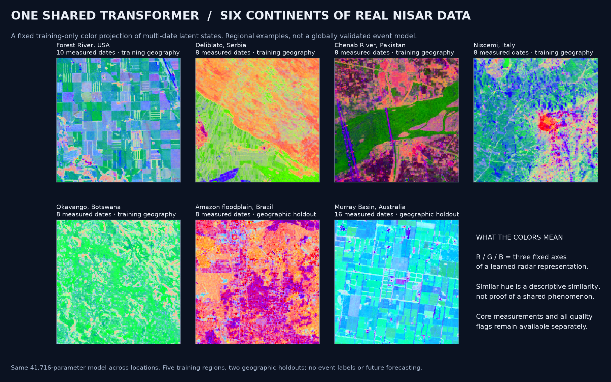
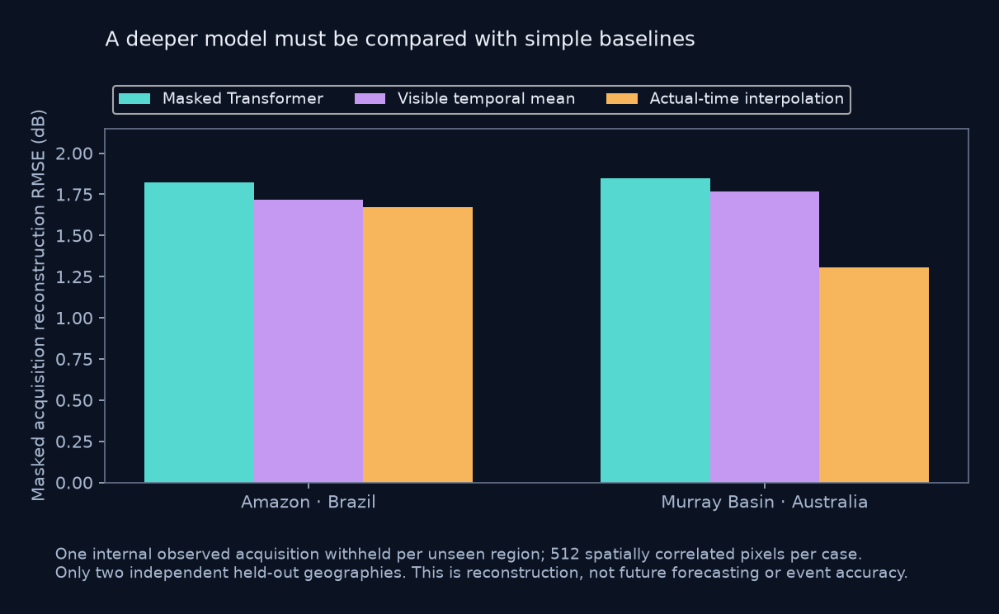
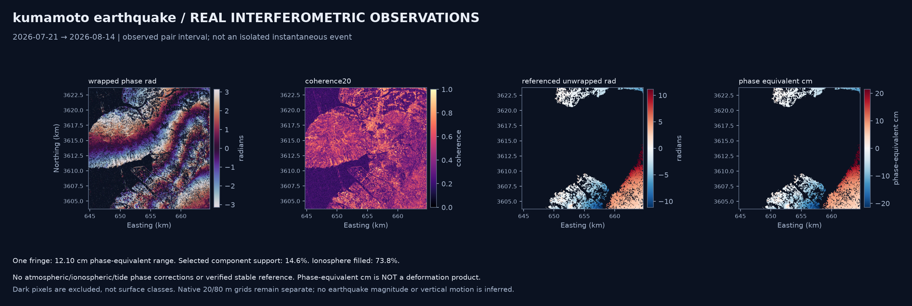

# Worldwide surface dynamics: implemented science worker

4 November 2026 · revised objective: observed dynamics for exploration, teaching and entertainment.

The active implementation is `src/surface_dynamics/`, with contracts in `contracts/` and teammate instructions in [TEAM_HANDOFF.md](TEAM_HANDOFF.md). The earlier forecasting proposal and DMD experiment are historical research, not the objective of this worker. There is no forecast module in its request contract. The mockup was used as context for the case themes and real measurements, not as a specification of preferred methods; it and the application frontend remain unchanged.

## What now runs

The same data-driven functions accept arbitrary WGS84 point/date requests or properly labelled measured cubes. Public CMR discovery groups compatible geometry, frame, bandwidth/polarization mode and acquisition identity. Authenticated reads retrieve quantitative HDF5 hyperslabs with bounded byte ranges; no browse imagery or invented acquisitions enter the models. Point-centered crops, projected metric coordinates, masks, source IDs and SHA-256 provenance are retained. Missing/incompatible data return explicit outcomes.

Seven regional GCOV examples contain **66 real acquisition chips across six continents**:

| Region | Context | Measured dates | Use |
|---|---|---:|---|
| Forest River, USA | Agriculture | 10 | Training geography and physical comparison |
| Deliblato, Serbia | Wildfire-region context | 8 | Training geography; no burn reference polygon |
| Chenab, Pakistan | Flood-region context | 8 | Training geography; no inundation/depth target |
| Niscemi, Italy | Landslide aftermath | 8 | Training geography; no pre-January-event observations |
| Okavango, Botswana | Wetland dynamics | 8 | Training geography; fresh point-centered measurements |
| Amazon floodplain, Brazil | Wetland/vegetation dynamics | 8 | Geographic holdout |
| Murray Basin, Australia | Agricultural landscape | 16 | Geographic holdout and longer temporal window |

An additional **live catalog→authenticated extraction→analysis** job at an arbitrary Botswana point completed through the public request contract. A ninth job analyzes a real NISAR pair bracketing the Kumamoto earthquake. All selected mission data retain provisional-product limitations. Source catalog snapshots are in `research/worldwide/catalog/`; accepted cubes are in `products/cubes/`.



## Methods, implemented rather than named

**Physical descriptions.** Linear power is averaged before dB. Outputs include temporal median, robust MAD, actual-date linear slope, largest observed step, per-transition rates and valid-date counts. Source support masks are not SNR or terrain-visibility masks. Directional structure-tensor texture and spatial FFT spectra describe spatial organization; they do not retrieve a calibrated roughness length. POD/SVD supplies spatial modes, temporal coefficients and explained variance without asserting governing equations.

**Temporal spectra.** A floating-mean sinusoidal least-squares periodogram is evaluated at actual acquisition dates, after removing a fitted linear trend. Its numerical implementation is tested against SciPy's generalized Lomb–Scargle routine. The search is conservatively limited to at least two cycles across the record and periods above twice median cadence. This is a display/search policy, not a universal Nyquist theorem for irregular samples. Regional max-statistic permutation diagnostics account for searching multiple frequencies, but their exchangeable-residual null does not model arbitrary temporal dependence. Candidate-period maps have no per-pixel significance claim. [SciPy reference](https://docs.scipy.org/doc/scipy/reference/generated/scipy.signal.lombscargle.html)

For sufficiently long records, Gaussian-window weighted sinusoidal fits provide a local time-frequency view at actual sample times. Effective support must be at least six observations and edge windows are masked. This is not a regular-grid CWT, and short cases explicitly lack this capability.

**Stochastic states.** A Matérn-3/2 Gaussian process fits shared channel covariance hyperparameters by empirical Bayes on sampled measured trajectories. Historical latent means and conditional SD maps are returned at observed dates; 256 full regional draws are retained. The regional mean is treated as one process with the fitted common covariance rather than dividing variance by pixel count. Kernel, residual and optimization/boundary values are recorded. Hyperparameter/mean/model uncertainty is omitted; residual variance is not an identified speckle component. These conditional model bands are uncalibrated. Separate spatial block-bootstrap intervals describe regional mean-dB heterogeneity. [Matérn kernel reference](https://scikit-learn.org/stable/modules/generated/sklearn.gaussian_process.kernels.Matern.html)

**Self-supervised DL.** A trained **41,716-parameter, two-layer bidirectional masked temporal Transformer** uses named polarization slots, missing-data masks and elapsed-time features. It reconstructs masked internal acquisitions, with no phenomenon label. Five training geographies and a separate validation stripe determine the checkpoint; Brazil and Australia are held out geographically. Per-date 48-dimensional states, pooled embeddings, a frozen training-only RGB basis and four-draw dropout sensitivity are exported. Later observations in the requested interval contextualize earlier states: this is descriptive reconstruction, not online inference or forecasting.

The implementation uses general masked-time-series ideas, not pretrained weights or a claimed reproduction. [Ti-MAE](https://arxiv.org/abs/2301.08871), [TimeMAE](https://arxiv.org/abs/2303.00320). CROMA/TerraMind were researched as alternatives, but native NISAR HH/HV/phase transfer was not verified and was not silently substituted. [CROMA official code](https://github.com/antofuller/CROMA), [TerraMind author model card](https://huggingface.co/ibm-esa-geospatial/TerraMind-1.0-base).

## The learned model's actual result

| Held-out region | Transformer masked-date RMSE | Visible temporal mean | Actual-time interpolation |
|---|---:|---:|---:|
| Amazon | 1.822 dB | 1.715 dB | 1.674 dB |
| Murray Basin | 1.849 dB | 1.770 dB | 1.305 dB |

The Transformer **does not beat these simple baselines on these two cases**. It is an experimental shared descriptive representation, not demonstrated superior global science. Attractive embedding colors do not establish performance or physical interpretability. The [model card](models/global_explorer_v1/MODEL_CARD.md), checkpoint, exact training log and fixed projection files are delivered together. More climates, acquisition modes, seasons and independent events are needed before stronger claims. The checkpoint declines band/polarization semantics it has not learned.



## Earthquake and InSAR result

The new real GUNW example spans **21 July→14 August 2026**, around the independently documented 28 July Kumamoto earthquake. Its wrapped phase/coherence and unwrapped/component/ionosphere layers come from authenticated quantitative NISAR reads. In this selected 20 km window:

- Median coherence is approximately **0.367**.
- Only **14.61%** remains in the selected coherent connected component at the declared threshold.
- **73.76%** of the supplied ionosphere estimates carry the masked/filled flag.
- At the actual 1.239 GHz center frequency, a complete phase cycle corresponds in magnitude to approximately **12.10 cm** of range-equivalent scale.

The result returns wrapped phase, coherence, referenced unwrapped radians, component/ionosphere masks and **phase-equivalent cm**. It explicitly returns `los_displacement_cm: null` and `deformation_attribution: null`. No atmospheric/ionospheric/tide removal, independently stable datum or verified geodetic sign supports a deformation measurement here. The pair can include coseismic, postseismic and atmospheric contributions together. [ASF GUNW correction definitions](https://nisar-docs.asf.alaska.edu/gunw/), [GSI event analysis](https://www.gsi.go.jp/uchusokuchi/20260728kumamoto-e.html).



An external GSI multi-mission vertical raster was downloaded with its DOI/credit, separately from our results. Its file lacks unit/nodata metadata, so no unverified rescaling, zero-as-nodata interpretation or quantitative worker output uses it. The USGS event query is preserved in `research/worldwide/kumamoto_usgs.json` as independent context, not as a model target.

## Deliverables for teammates

Each job has an explicit contract/result manifest with per-module capability, real dates, named channels, CRS/bounds, sources, units, artifact hashes, evidence-linked observations and interpretation limits. The current real-data audit verifies **152 registered artifacts across nine jobs**. Outputs include COG, NetCDF, CSV, full conditional draw arrays, per-date latent vectors, static figures, fixed-color observed animations and contextual-state animations. A point/region probe extracts trajectories from the emitted NetCDF for map exploration. See [the handoff](TEAM_HANDOFF.md).

Physical/spectral/stochastic processing is location-independent within its supported measurements and resource limits. **Worldwide processing capability is not globally validated learned-model accuracy.** A theme supplies teaching questions and candidate mechanisms, not a classifier label. There is no forecast or event-probability output.

## Reproduce and verify

The isolated `.venv` avoids the inherited Conda/PyTorch duplicate OpenMP-runtime conflict found in the old scratch environment. `pip check` reports no broken dependencies. Installation on another CPU machine:

```powershell
python -m venv .venv
.venv\Scripts\python.exe -m pip install torch==2.11.0 --index-url https://download.pytorch.org/whl/cpu
.venv\Scripts\python.exe -m pip install -r requirements-lock.txt
.venv\Scripts\python.exe -m pip install -e . --no-deps
.venv\Scripts\python.exe -m unittest discover -s tests -v
.venv\Scripts\python.exe scripts\train_global_example.py
.venv\Scripts\python.exe scripts\run_global_examples.py
```

The current run passes **22 offline tests**, including spectral agreement with SciPy, masking/leakage, phase-component separation, four-timestamp GUNW event bracketing, finite/positive physical units, projected-coordinate validation, COG values/georeferencing, a fresh CF-metadata worker job, no-data behavior, network topology/series separation, cache identity and packaged-contract consistency. Real-product checks independently verify acquisition counts, hashes, coordinate/value preservation, GIF frames, fixed projection use, pooled/per-date latent consistency and the earthquake deformation guard. See `docs/results/verification.json`.

## Version 0.2: expanded independent checks

The frozen model was evaluated on **all 20 internal acquisition dates** in the two held-out regional cubes, hiding each complete date separately. A deterministic sample of 512 spatially correlated pixels per case is scored only where the target and nearest valid observations on both sides exist, identically for every method. This expands evaluation without retraining, selecting weights or tuning on those holdouts. The aggregate Transformer/visible-mean/interpolation RMSE is **1.600 / 1.178 / 1.211 dB** for Amazon (six dates), and **3.637 / 3.007 / 2.254 dB** for Murray (14 dates). The earlier single-date table above is retained as the original experiment, not substituted for this broader test. The model still underperforms both baselines; overlapping windows do not increase the number of independent geographic cases. Full per-acquisition scores and checkpoint hash are in [the expanded benchmark](docs/results/model_benchmark_all_dates.json).

The new InSAR network planner groups real GUNW catalog pairs into separate compatible series, computes connected components and minimum-temporal-baseline forests, and identifies fundamental closure paths. The actual Kumamoto point yields three compatible networks with 7, 8 and 8 edges respectively; all three are chains with zero closure-cycle rank. This is a measured availability result, not a phase-closure test or an inversion. See [the real network result](docs/results/kumamoto_network.json). A graph can be connected while ground support, stable datum and correction quality remain inadequate. The [MintPy workflow](https://mintpy.readthedocs.io/en/latest/) is the reference context for future common-reference, closure and corrected time-series processing; it is not claimed as implemented here.

The new pair observability sweep shows selected coherent support decreasing from **18.81%** at coherence 0.20 to **1.50%** at 0.70. At the default 0.35 threshold, **96.30% of the selected component** has an ionosphere-filled flag, versus 73.76% over the whole unwrapped window. These different denominators are now explicit. Only **0.5408% of the full window** is both coherent at 0.35 and ionosphere-unfilled; absence of that fill flag alone does not establish reliable ionosphere removal, and no correction is applied. Improved schema/grid/quality validation and point/extent-aware cache checks guard future global processing.

Eight fresh public-catalog point queries across the configured example regions all returned compatible network results: **27 separate networks and 211 unique day-pair edges** after deduplication and baseline filtering. None had a redundant closure cycle. These are catalog-only checks, not eight measured InSAR stacks or universal coverage; `quantitative_phase_reads` is zero for the network checks. See [the recorded acceptance summary](docs/results/global_network_checks.json).

Use UTC acquisition dates at day resolution in these cubes; source granule identities preserve the full acquisition times. Sparse sampling, noise-floor/calibration differences, unmodeled forcing and unresolved terrain visibility remain material limits. The initial crop-placement error in new regional downloads was detected by point/coordinate checks and corrected before accepted model training and analysis. No model approach from the older classification projects was reused; the authorized protected credential was read only in memory.
