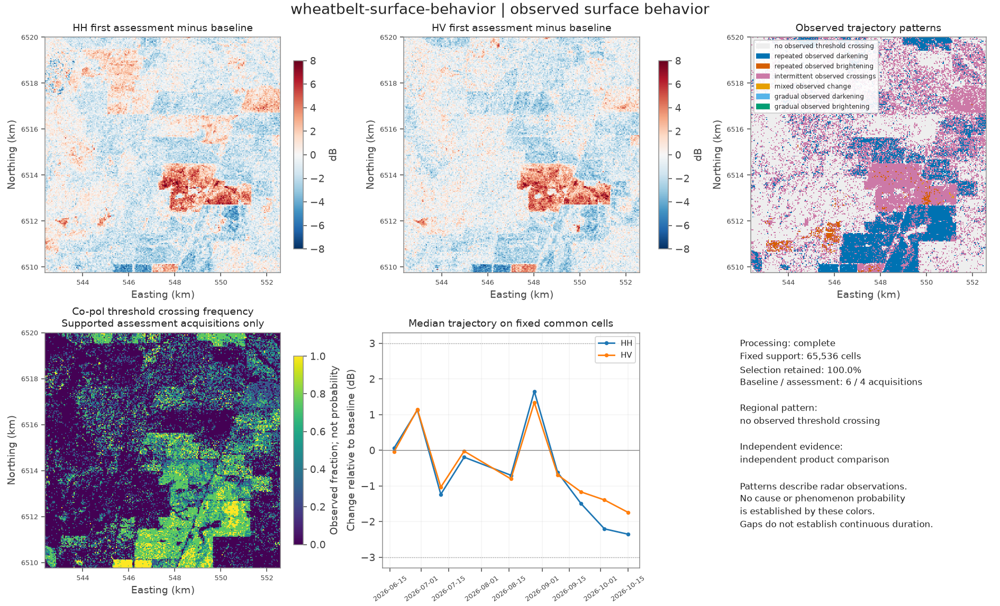
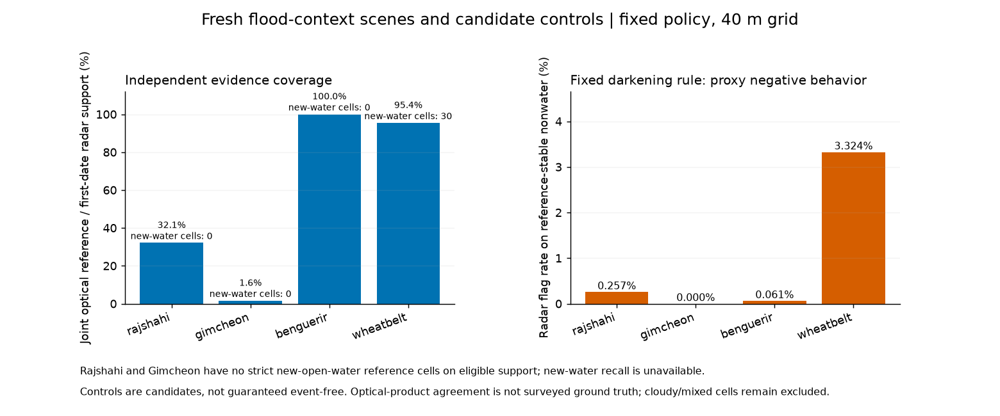
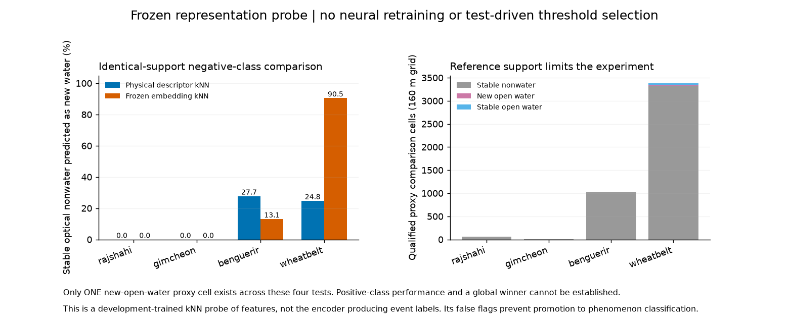
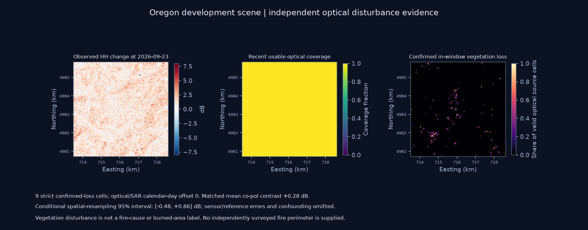

# Version 0.5: traceable reports of observed surface behavior

The new `characterize` worker answers **what changed, when it was observed, how the trajectory behaved, which independent evidence is usable and which alternative explanations remain**. It supports the exploration themes through one report contract. Theme names supply context and candidate mechanisms; they are not classifier outputs. The frontend and mockup remain untouched.

Eight shared reports, four fresh fixed-policy flood comparisons and two new Venezuela InSAR jobs produce **291 independently checked artifacts**. Five new measured scenes add **42 quantitative GCOV acquisitions**. The frozen Transformer and flood thresholds are unchanged. **70 offline tests pass.**

There were 43 nominal selected GCOV chips. The 7 September Ben Guerir chip had zero supported finite positive samples and was excluded on measurement support, with its source and reason retained in processing provenance. No synthetic date replaces it.

## What the shared report adds

The report compares cellwise radar dB against each cell's declared baseline median. It retains the **same measured cells at every selected baseline and assessment date**, across the chosen co-/cross-pol channels. Counts, retained fraction, acquisition dates, source hashes and polarization semantics remain explicit. A point or metric-radius selection can be applied to a measured cube; an unsupported selection returns NoData rather than zero change.

Outputs include channel-level mean/median/quantiles, polarization-ratio change, observed timing brackets, spatial trajectory-pattern counts, actual-date trajectories and linked method/evidence artifacts. A regional median can conceal localized behavior, so its pattern and the distribution of cell patterns are reported separately. The Wheatbelt regional median never crosses the diagnostic threshold even though 10,296 cells show repeated observed darkening and 21,152 show intermittent crossings under the fixed policy.

The [behavior policy](../contracts/behavior-policy.json) uses a 3 dB co-pol change threshold and minimum three baseline/two assessment dates. Repeated change requires at least two acquisitions and 75% of assessment dates. Gradual-pattern diagnostics additionally require six dates, a consistent step direction, no single dominant step and no gap larger than twice the median cadence. These are transparent exploratory definitions, not calibrated natural-process classes. Dates between observations remain unresolved. Insufficient support is its own code, rather than a stable-surface label.

Physical, actual-time spectral and empirical-Bayes Matérn GP outputs remain available as component artifacts. Spatial bootstrap regional means now weight block sums by retained **cell counts**, instead of equally weighting unequal-population block means. Their complete-support/block selection and denominator are recorded in method metadata. Existing versioned products retain their original recorded values. GP bands, spatial resampling intervals, spatial quantiles and product-reported uncertainty remain different quantities.

## Frozen new flood and control observations

Candidate coordinates, windows, reference rules, original flood thresholds and neural weights were hashed before the new radar/reference agreement was inspected. The source/data freeze for the representation probe was written before opening its fresh labels or scores. Sites were not relocated or replaced after results were seen. The [selection protocol](../configs/characterization_v05.json), [initial freeze](results/characterization_v05_protocol_freeze.json) and [probe freeze](results/representation_probe_v05_freeze.json) preserve the record.

| Scene / declared role | Baseline / assessment dates | First assessment | Joint optical / first-date radar support | Strict new-water reference cells | Fixed-rule flag rate on reference-stable nonwater |
|---|---|---|---:|---:|---:|
| Rajshahi, Bangladesh / flood context | 6 / 4 | 17 Sep 2026 | 32.10% | 0 | 0.257% |
| Gimcheon, South Korea / flood context | 1 / 5 | 10 Jul 2026 | 1.59% | 0 | 0.000% |
| Ben Guerir, Morocco / candidate control | 5 / 3 | 19 Sep 2026 | 100.00% | 0 | 0.061% |
| Western Australian Wheatbelt / candidate control | 6 / 4 | 9 Sep 2026 | 95.40% | 30 | 3.324% |

The [GDACS Bangladesh account](https://www.gdacs.org/report.aspx?eventid=1104156&eventtype=FL) and [International Charter Korea activation](https://upload.disasterscharter.org/activations/flood-in-korea-republic-of-activation-1040-) document regional events, not surveyed local flood polygons. The Bangladesh first radar assessment is after the reported interval; its full-series fixed support retains only 2,768 of 16,384 grid cells. The table's optical fraction uses the separate fixed flood policy's first-date radar denominator, not the shared report's stricter full-series common mask. Those populations must not be silently pooled.

Gimcheon has only one compatible pre-event date and very little usable pre-reference optical coverage. Both flood-context sites have **no strict new-open-water reference positives on scored support**, so flood recall is unavailable. This does not establish that local flooding never happened. The candidate controls are not guaranteed event-free: the Wheatbelt reference includes a small new-water group. Negative behavior is evaluated on qualified reference-stable predominantly nonwater cells, not by declaring the entire control scene dry.

The inherited 3 dB co-pol/1.5 dB cross-pol rule remains a signal diagnostic. The new control results demonstrate that season, moisture, management and other scattering changes can trigger it. [Full new fixed-policy summaries](results/fresh_flood_validation_v05.json) retain confusion counts, null denominators, group counts, baseline sensitivity and matched-control results.

## Does the frozen learned representation help interpretation?

The new experiment fits the same fixed five-neighbor probe to either eight physical features or 48 frozen constant-control state-change coordinates. Development examples come only from the earlier Chokwe, Qadirabad and Richmond scenes. Both methods use identical sampled development cells and identical qualified test support. Feature centering/scaling uses development samples only; no neural weights are retrained.

Forty-metre linear power is explicitly block averaged to the checkpoint's 160 m posting. Optical source-class fractions are coarsened with valid-coverage weights, and class thresholds are reapplied. Actual HH/HV channels, exact grid centers and complete observed trajectories are retained; there is no hidden interpolation or substitution of VV/VH. The proxy groups are stable predominantly nonwater, new strict open water and stable strict open water.

| Scene | Qualified 160 m proxy cells | New-water proxy cells | Physical-feature kNN: stable nonwater predicted as new water | Embedding kNN: same flag rate |
|---|---:|---:|---:|---:|
| Rajshahi | 56 | 0 | 0.0% | 0.0% |
| Gimcheon | 9 | 0 | 0.0% | 0.0% |
| Ben Guerir | 1,024 | 0 | 27.7% | 13.1% |
| Wheatbelt | 3,380 | 1 | 24.8% | 90.5% |

**There is no evidence here to promote the embedding probe to phenomenon classification.** It produces severe nonwater false flags in the Australian control. The physical-feature probe is also unreliable for this labeling task. Only one new-water proxy cell exists across all four tests, so positive-class ability and a global winner cannot be established. Per-class support and all confusion matrices remain available in [the full probe result](results/representation_probe_v05.json); a single-cell recall must not be treated as reliable validation.

This is a limited retrieval/classification probe of features, not the Transformer itself producing event labels. Its optical transition proxy is not independent physical-behavior ground truth. Spatially correlated cells do not create thousands of independent geographic tests. The 160 m probe and 40 m fixed radar rule have different support/definitions; their percentages are not a matched head-to-head comparison.

## First optical disturbance adapter for a wildfire-context scene

The Oregon case combines eight NISAR acquisitions with **OPERA DIST-ALERT-HLS** optical vegetation-disturbance evidence. The [USGS Rowe Creek account](https://www.usgs.gov/media/images/rowe-creek-complex-fire-oregon-2026) supplies regional context. The a priori point is a scene candidate; overlap with a burned perimeter is not assumed.

The adapter reads the quantitative V1 vegetation status, first-disturbance date and last-assessed-observation date. It admits the product's confirmed ongoing/finished classes, excludes disturbances beginning outside the declared assessment window, and requires a recent assessed observation within seven calendar days of the corresponding radar date. This avoids treating a cumulative or stale optical status as new event evidence. Source-class shares are not percent burned area. [OPERA product overview](https://www.jpl.nasa.gov/go/opera/products/dist-product-suite/), [official V1 specification](https://d2pn8kiwq2w21t.cloudfront.net/documents/OPERA_DIST_HLS_Product_Specification_V1.pdf).

At the selected 23 September optical/radar comparison, recent optical support covers the fixed radar population, but only **nine cells** meet the strict confirmed in-window vegetation-loss definition. Their median HH change is **+1.37 dB** against baseline. The nine matched positive/control cells have a mean contrast of **+0.28 dB**, with conditional spatial-resampling interval **[-0.48, +0.86] dB**. This is weak evidence for a distinct radar response in this small group, and does not validate a fire scar. Harvest, clearing, drought and other processes remain possible; no surveyed fire perimeter or wildfire attribution is supplied. The report keeps burned area and cause unavailable.

## A new earthquake/InSAR candidate

Three actual Venezuela intervals span **1-13 June**, **13-25 June** and **25 June-7 July 2026**, around the independently reported [24 June earthquake sequence](https://www.paho.org/sites/default/files/2026/06/ven-earthquakessitrep124jun2026v2-1.pdf). A 15 km epicentral window and compatible series were recorded before quantitative phase inspection. The window has **17,311 common coherent selected-component cells (48.98%)**, substantially more common phase support than the previous Kumamoto example.

However, only **two cells** also have an unfilled finite ionosphere screen and positive reported uncertainty across every interval: 0.00566% of the full grid. Both compatible catalog networks have zero redundant closure cycles. No independent stable reference or geodetic validation is supplied. The result therefore stays `not_displacement_ready`, with null corrected LOS displacement. More coherent pixels do not by themselves resolve correction quality. [Candidate audit](results/venezuela_insar_v05.json), [ASF correction definitions](https://nisar-docs.asf.alaska.edu/gunw/).

## Validation and next scientific decision

The [validation report](CHARACTERIZATION_V05_VALIDATION.md) and [machine verification](results/characterization_v05_verification.json) document the checks. The shared input/output contract is in [CHARACTERIZATION_V05_CONTRACTS.md](CHARACTERIZATION_V05_CONTRACTS.md). Existing physical, spectral, stochastic and learned methods remain useful for exploration within their measurement/support limits; these tests do not establish global event-label accuracy.

Further model changes need newly reserved geographic/event/season cases with enough independent positives, suitable quiet-reference support and near-coincident observations. These inspected tests are now consumed for development. The next neural generation should be assessed on interpretation tasks with adequate reference support; a larger network alone would not address the missing evidence exposed here.
