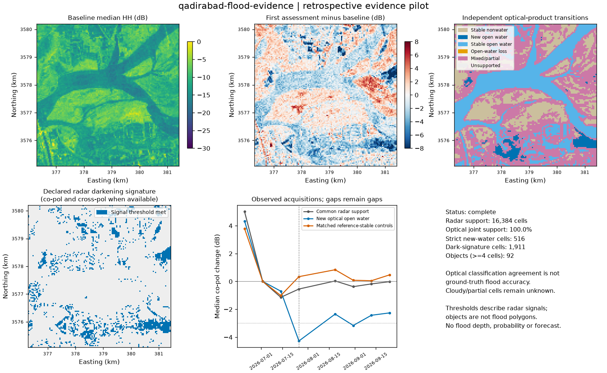

# Evidence-linked surface characterization: v0.4

The flood pilot connects **observed radar changes to independent optical-water evidence**, with explicit alternatives, missingness and timing. It adds a physical interpretation layer to the existing spectral, stochastic and frozen Transformer explorers. It does not train a flood classifier or forecast future events. Three inspected development scenes are not a global benchmark.

## What the real cases show

All inputs are quantitative NISAR GCOV measurements, spatially averaged in **linear gamma0 power before conversion to dB**, on 40 m analysis grids. The reference is independently produced **OPERA DSWx-HLS optical classification**, not SAR-derived water, a rendered image, a surveyed flood polygon or error-free ground truth. Twenty-one accepted acquisition chips supply five, eight and eight dates respectively.

| Scene | Baseline / assessment dates | First assessment | Joint usable optical support / radar support | Strict new-open-water reference cells | Matched-positive minus control mean HH change |
|---|---|---|---:|---:|---:|
| Chokwe, Mozambique | 4 / 1 | 17 Jan 2026 | 22.80% | 440 | -4.34 dB; 382 matched pairs |
| Qadirabad, Pakistan | 3 / 5 | 26 Jul 2026 | 100.00% | 516 | -4.93 dB; 463 matched pairs |
| Richmond, Indiana | 4 / 4 | 16 Aug 2026 | 13.23% | 0 | Unavailable |

The nominal analysis cell is 0.16 ha. Multiplying a mask count by this value gives **area of analysis cells meeting that definition**, not a retrieved inundation area, flood depth or water volume. Richmond's grid contains partial native SAR support; optical support is reported against the 40,390 radar-supported cells, rather than its full 65,536-cell grid. Qadirabad's 100% usable reference coverage includes **7,609 mixed/partial cells** that remain outside the strict binary comparison.

**Chokwe:** the independent optical comparison is 7 January versus 22 January, two and five days from the corresponding radar acquisitions. The strict new-water group has a median HH change of -2.35 dB, below the magnitude of the declared 3 dB diagnostic threshold. It darkens relative to matched controls, but cloud exclusions, a wet-season baseline, beta product calibration and just one assessment acquisition limit the interpretation. Temporal persistence or confirmed signal return cannot be measured here. [NASA's flood account](https://svs.gsfc.nasa.gov/5661/) supplies scene context, not pixel labels.

**Qadirabad:** the optical comparison is 17 July versus 2 August, three and seven days from radar on 14 and 26 July. New strict optical-water cells show a median HH change of -4.27 dB against the multi-date baseline. The fixed radar rule has proxy precision 29.70%, recall 64.34% and IoU 25.50% on 8,775 unambiguous reference cells. Much of its disagreement comes from already-open water: 17.03% of stable optical-water cells trigger the rule, versus 0.98% of reference-stable predominantly nonwater cells. Darkening alone cannot distinguish new water from changing scattering on existing water. The [PMD/FFD bulletin](https://ffd.pmd.gov.pk/b/eacdcd80-11ca-4316-a9e9-e337e5c7d8fd) is regional event context; these different acquisition intervals do not establish attribution to that reported event.

**Richmond:** the first radar assessment is three days after the reported 12-13 August interval; the optical post-reference is 21 August. No strict new-water group is resolved on the small jointly usable reference subset. This is **insufficient evidence to establish local inundation**, and does not show that short-lived flooding never occurred. Recall against new-water reference cells is null because there are no positives. The [NWS account](https://www.weather.gov/iln/20260813) documents heavy rain in Wayne County and Whitewater River rises, not a pixel-level inundation map.

## Fixed diagnostic policy and sensitivity

The published [policy](../contracts/flood-policy.json) uses co-pol change <= -3 dB and, when measured, corresponding cross-pol change <= -1.5 dB for the first-assessment darkening signature. HH/HV or VV/VH are selected by channel name. Co-pol brightening >= 3 dB is retained as a separate signal, with no automatic water or double-bounce label. The assessment is the **first actual acquisition in the declared window**, never the date with the strongest response.

The baseline is the per-cell median of declared acquisitions with at least 75% support and at least three dates when available. With fewer than three baseline acquisitions, descriptive differences can still exist, but robust scaled change is unavailable. The robust scale is 1.4826 times baseline median absolute deviation with a 1 dB floor; the resulting quantity is not a Gaussian significance test. No thresholds were fitted to these scenes or optimized against optical agreement.

An additional diagnostic exposes **first-assessment minus last-baseline acquisition** using the same thresholds. It was added after inspecting the development results to disclose comparator sensitivity, not to select a better scoring rule. Qadirabad's proxy precision/recall become 90.38% / 45.54%, with stable-water flag rate 0.18%. This large difference is evidence of baseline sensitivity, not validation of an improved classifier. Both versions remain in the result. The multi-date radar baseline and optical snapshot transition cover different temporal support.

Controls are selected without replacement from reference-stable predominantly nonwater cells, using **baseline co-/cross-pol levels only**, within 2 dB in each channel and at most 16 nearest candidates. Only matched positive cells enter the reported contrast. Baseline balance, retained fractions and both masks are exported. These are observational controls; matching does not identify a causal flood effect. Intervals resample 8x8 spatial blocks 400 times with fixed seed, weighting block sums by valid-cell counts. They describe conditional spatial resampling sensitivity and omit sensor/reference error, unknown spatial dependence and unmeasured confounding.

## Independent reference and missingness

The [official DSWx-HLS specification](https://d2pn8kiwq2w21t.cloudfront.net/documents/OPERA_DSWx-HLS_ProductSpec_v1.0.0_D-107395_RevB.pdf) defines WTR 0 as nonwater, 1 as open water and 2 as partial water. Classes 252-255 are snow/ice, cloud-related masking, masked ocean and fill. We aggregate one-hot classes with area-average reprojection. Invalid source cells contribute **zero valid coverage**, rather than disappearing from the denominator. Fractions describe the share of valid source cells assigned a class, not retrieved subpixel water fraction.

A comparison cell requires >=80% valid coverage in both epochs. Strict open water requires >=80% open-water class share. Predominantly nonwater requires <=20% open-water and <=20% partial-water class share. Partial/mixed transitions remain ambiguous. Strict new water, stable water, water loss, stable predominantly nonwater, mixed and unsupported groups remain separate. All unambiguous non-new transitions are negatives for the declared new-water proxy comparison; unknown/mixed cells are excluded rather than counted as dry land.

Discovery searches within seven calendar days of each radar snapshot, with pre-reference before assessment start and post-reference on/after it. Up to 16 candidates are ranked on temporal distance and coverage alone: nearest date among candidates with >=50% usable grid cells, otherwise highest coverage. The cap was increased from 8 to 16 before any radar/reference agreement was computed. Full sensing timestamps and selection metadata remain in provenance; calendar-day offsets do not imply simultaneous measurements. See [OPERA's product overview](https://www.jpl.nasa.gov/go/opera/products/dswx-product-suite/).

The three declared scenes have agricultural, vegetated or settled surroundings, but no independently validated pixel-level land-cover labels. This pilot therefore does not demonstrate urban, under-canopy or vegetation-specific flood accuracy. Oahu March 2026 was considered and rejected because the checked collections returned no matching point/window GCOV acquisitions. Richmond's series was selected for earlier event observation with sufficient baseline dates before agreement was inspected; the superseded later series is not pooled into the result.

## Interpretable artifacts

Each job exports a validated JSON manifest, georeferenced NetCDF arrays, five COGs, group trajectories, GeoJSON radar-signature objects and a scientific preview. Four-neighbor connected dark-signature objects of at least four cells are reported, capped at 100 by area; they are **not flood polygons**. All raw labels remain in NetCDF, including smaller components. Object trajectories use actual acquisition dates and require >=80% object support at each date.

First change is bracketed by the last observed reference-like signal and first threshold-crossing observation. Return requires two successive observed acquisitions within 1.5 dB of baseline. Acquisition gaps remain gaps: observed change span is not continuous flood duration, and radar signal return is not ecosystem or hydrologic recovery. After-only or cloudy evidence stays partial. `complete` means the declared processing/support requirements were met; it never means a confirmed or globally validated flood interpretation.

See [the integration contract](CHARACTERIZATION_CONTRACTS.md), [validation report](FLOOD_VALIDATION.md), [machine verification](results/flood_pilot_verification.json) and [real case summaries](results/flood_pilot_summary.json).

## Parallel earthquake/InSAR result

The new correction-readiness audit examines the same three measured Kumamoto intervals used in v0.3. In the 5 km window, no common selected-component phase support exists. The 15 km window has 1,614 common coherent cells, but only **3** also have finite, unfilled ionosphere screens and positive reported uncertainty in every pair: 0.00849% of the full grid, or 0.1859% of common phase support. The declared eight-cell reference eligibility policy is not met. At coherence thresholds 0.20/0.35/0.50/0.70, common eligible input counts are 6/3/2/0; lowering the threshold does not solve the problem.

Finite supplied screens and positive reported uncertainty do not establish correction accuracy. No screen is applied; no atmospheric/tidal correction, validated stable reference, sign convention, closure check or displacement inversion is established. Both audits return `not_displacement_ready` and null LOS displacement. The JSON provides the remaining gates and required inputs. The [ASF GUNW guide](https://nisar-docs.asf.alaska.edu/gunw/) documents supplied phase/correction layers; choosing a correction sign by image appearance is not validation.

The next scientific expansion is an independently labeled, geographically and seasonally separated evaluation with near-coincident reference data, terrain visibility and land-cover support. Agriculture, wildfire and landslide adapters should reuse these evidence/provenance patterns with appropriate independent references. The frozen Transformer is unchanged; new class claims need evidence beyond reconstruction or latent colors.
