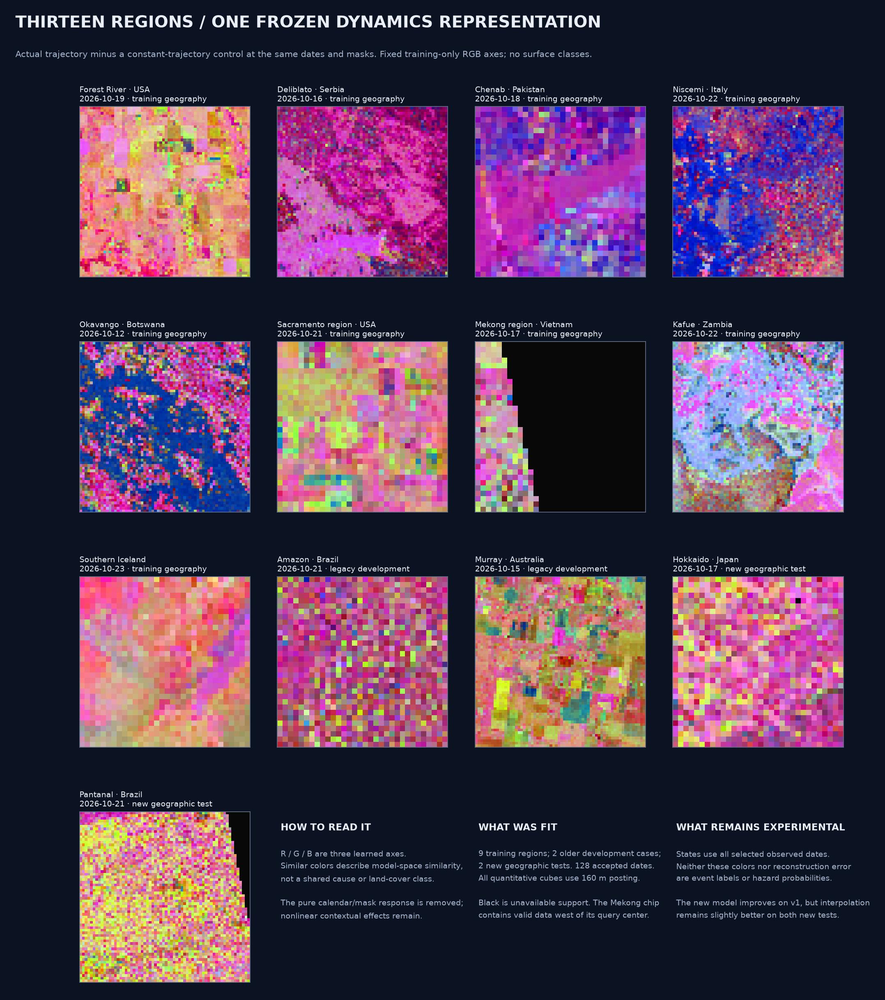
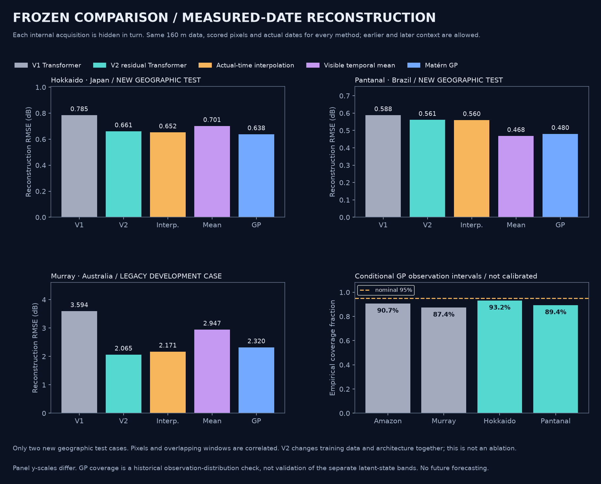
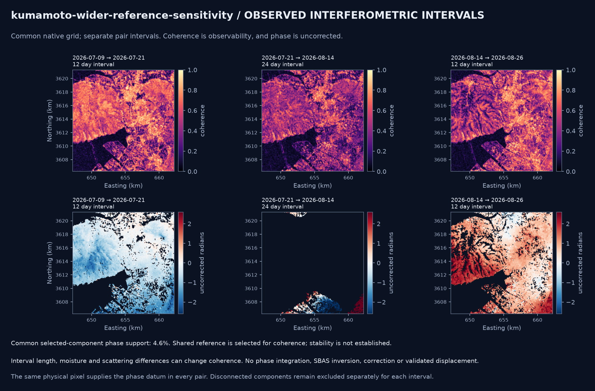

# Modeling continuation: measured surface dynamics and InSAR intervals

This experiment continues the exploration/teaching objective. It adds a trained candidate, broader measured data, stronger uncertainty checks and multi-pair interferometry. No frontend or mockup file is changed. No forecasting or automatic phenomenon classifier is introduced.

## What is delivered

- **Thirteen real regional time series**, all at 160 m posting: nine training regions, two older development cases and two new geographic tests. California, Mekong, Kafue, Iceland, Hokkaido and Pantanal add 63 newly read quantitative chips. There are 129 nominal regional chips and **128 accepted observed dates** after excluding one wholly invalid Pantanal acquisition.
- A **42,292-parameter residual masked temporal Transformer**, trained from scratch with visible-only normalization and actual observation gaps. Weights and training-only projections are in `models/global_explorer_v2/`.
- Raw contextual states plus a **constant-trajectory control contrast**, fixed RGB views, actual-day latent contrast rates, COG layers, NetCDF arrays, animations and map-probe results.
- A frozen **34-acquisition reconstruction comparison** across four regions, including 14 masked dates in the two new geographic tests; visible-only Matérn GP uncertainty diagnostics complement the learned model and simple baselines.
- A real **three-pair Kumamoto InSAR stack**, with exact native-grid intersection, coherence interval contrasts, common connected-component support and an explicit common-reference gate. Separate 5 km and 15 km examples make the sensitivity to usable reference support visible.



## Results that determine the interpretation

The full model/protocol details are in the [v2 model card](../models/global_explorer_v2/MODEL_CARD.md). On the two new geographic tests:

| Region | V1 RMSE | V2 RMSE | Interpolation | Visible mean | Matérn GP |
|---|---:|---:|---:|---:|---:|
| Hokkaido | 0.785 dB | 0.661 dB | 0.652 dB | 0.701 dB | 0.638 dB |
| Pantanal | 0.588 dB | 0.561 dB | 0.560 dB | 0.468 dB | 0.480 dB |

V2 improves on v1 but **does not beat interpolation in either new region**. It is an exploratory representation candidate, not a demonstrated universally better measurement model. The newer comparison uses a common 160 m grid/support; it should not be compared directly with earlier mixed-posting metrics. Changes in training data and architecture are confounded. Pixels and overlapping temporal windows do not create additional independent geographic replications.

The GP's nominal 95% conditional observation intervals cover 93.21% and 89.39% of the Hokkaido and Pantanal scored targets. These are empirical checks on two regions, not globally calibrated uncertainty. They do not validate the separate latent-state posterior bands shown in ordinary jobs.



## InSAR: observable intervals and honest phase support

The compatible real pairs span **July 9→21**, **July 21→August 14**, and **August 14→26, 2026**, around the independent July 28 earthquake context. Pair duration is 12, 24 and 12 days respectively. In the 5 km window, median coherence on the same spatial support is approximately **0.606, 0.428 and 0.497**. The middle interval has no supported unwrapped component there. The result is `partial`, with coherent observations retained but all shared-reference phase arrays unavailable—not zero motion.

A separate 15 km reference-support sensitivity window finds **1,614 common pixels, or 4.57%** of the grid, at the 0.35 coherence threshold. It uses one physical pixel in the supported component of every pair, selected by maximum minimum coherence. Its stability is **not established**, and it may itself move. Different component IDs are local labels and are never matched numerically across dates.



No atmospheric/ionospheric/tide corrections, phase integration, SBAS inversion, LOS/vertical displacement, magnitude estimate or confirmed earthquake attribution is performed. `los_displacement_cm` remains null. The longer middle baseline, scattering, moisture and processing are confounds; a coherence decrease alone is not an earthquake detector. The [ASF GUNW documentation](https://nisar-docs.asf.alaska.edu/gunw/) explains the supplied phase/correction layers; the [MintPy workflow](https://mintpy.readthedocs.io/en/latest/) supplies context for future corrected time-series work, not an implemented dependency.

## How the backend team can use it

The [handoff](../TEAM_HANDOFF.md) and versioned [contracts](../contracts/) describe the full inputs/outputs. Live global analysis can request `target_posting_m: 160`; it is mutually exclusive with `aggregate_pixels`. The factor must be a whole native-pixel block, and quantitative power is averaged before dB. Cached chips now require the requested source identity as well as point/size; cached InSAR reads also retain extent/layer checks.

`insar-stack` accepts either two to six trusted local pair fixtures or a worldwide point/date window, optional compatible series key, pair cap and bounded extent. Both pair acquisition dates must be inside its requested window. Results include pair dates/duration, masks, common-spatial-support coherence histograms/medians, uncorrected shared-pixel phase when available, COG contrast layers and an artifact manifest. Native pixel centers are intersected; no hidden resampling is performed. Stack reads can retrieve only the unwrapped native layers, avoiding unnecessary wrapped-raster transfers.

For per-date model maps use `dynamic_rgb_time`; for a selected point use `dynamic_latent_at_observed_dates`. State contrasts and rates carry latent units and have no class semantics. Probe outcome `no_valid_observations` distinguishes an unobserved point inside the grid from a point outside it. Query/grid coverage is not proof of measurements at that pixel: the Mekong example deliberately exposes this distinction, with valid observations west of an unobserved center.

The new QA also preserves exclusions of wholly empty dates, masks texture at NoData pixels, uses north/east metres for gradient-axis orientation and separate x/y posting for spatial frequencies, and computes dB without flooring a valid small positive power. Older saved products retain their original versioned semantics; the new outputs record the explicit orientation convention.

## Reproduce

After restoring the release fixtures and installing the package:

```powershell
python scripts/run_global_v2.py
python scripts/report_global_v2.py
python scripts/verify_global_v2.py
python -m surface_dynamics analyze contracts/examples/hokkaido-v2.json --output products/example_hokkaido
python -m surface_dynamics insar-stack contracts/examples/kumamoto-stack-offline-wide.json --output products/example_insar_stack
```

Live chip acquisition uses `scripts/prepare_global_v2.py --download` and credentials only from the process environment. Independent HDF5 downloads use bounded subprocesses because [h5py serializes its API within an interpreter](https://docs.h5py.org/en/stable/threads.html). Raw quantitative chips remain local and source hashes are preserved. Nothing reads the frontend or mockup.

`evaluate_global_v2.py` writes a freeze record before reading test scores and refuses to silently overwrite an existing evaluation. Repeated test-driven tuning would consume those tests; a future model generation needs newly reserved geographic/event/season tests. Reconstruction is one diagnostic; the learned views still need independent representational/physical evaluation before stronger scientific claims.
