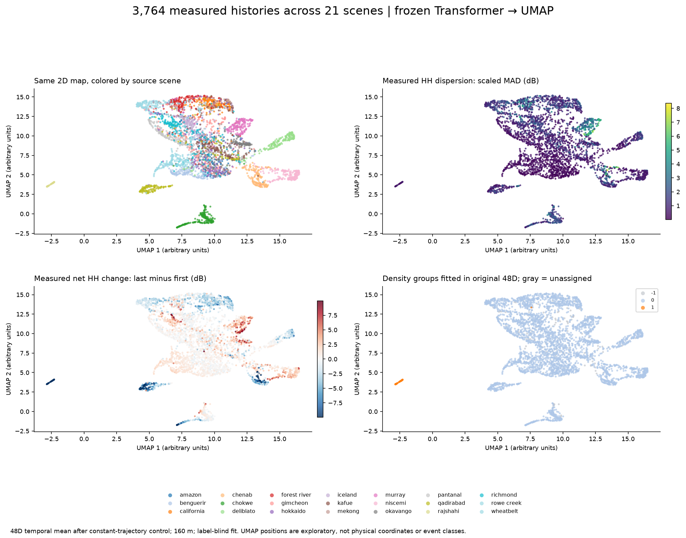
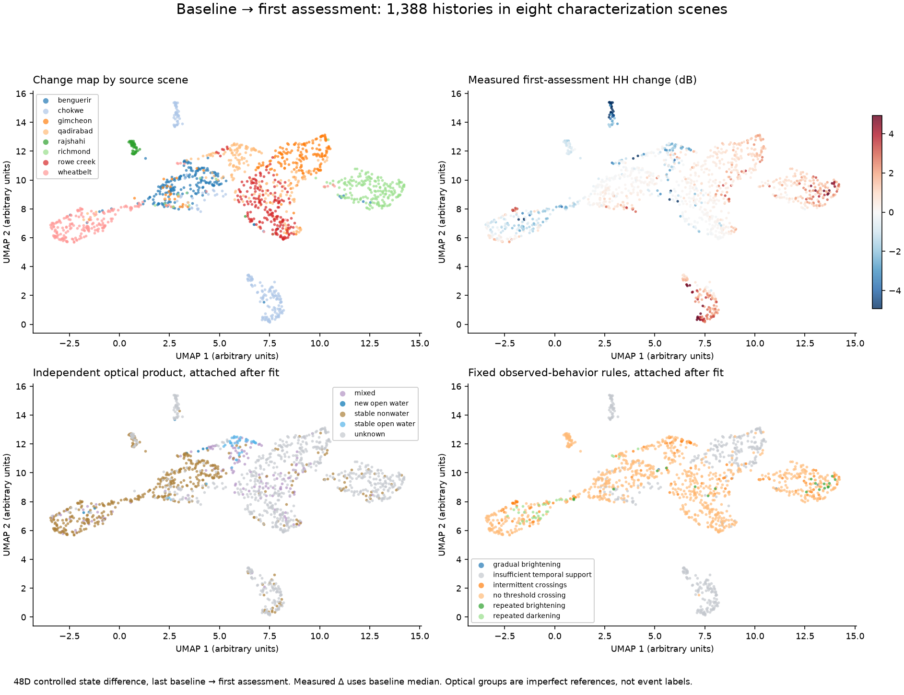
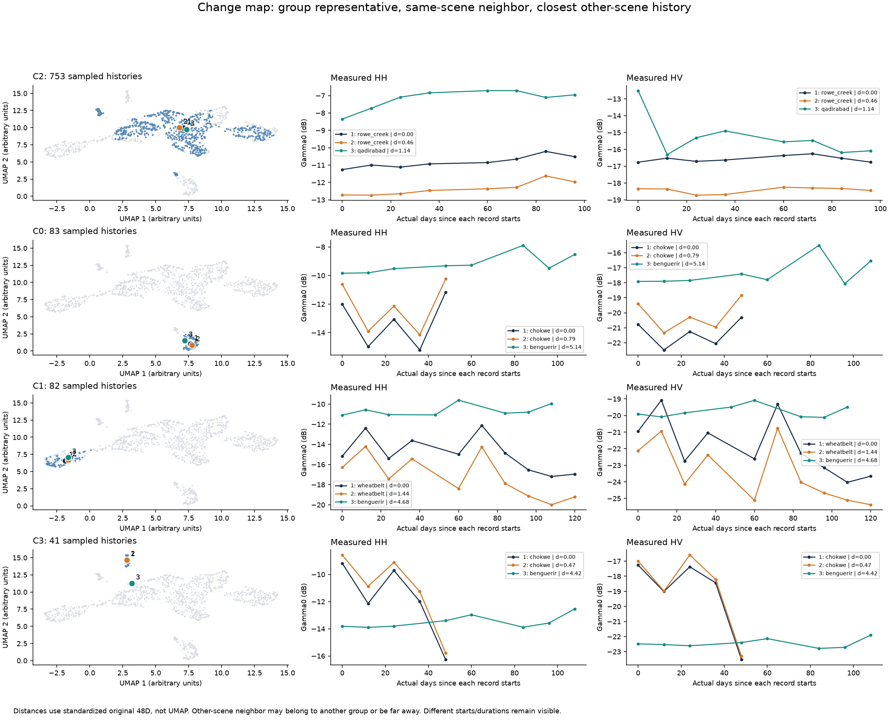

# Exploring the frozen radar representations with UMAP

The atlas shows **3,764 complete measured HH/HV histories in 21 existing scene windows** at 160 m. A separate change map shows **1,388 histories in the eight characterization scenes**. The encoder is unchanged. This is an unsupervised exploration of already consumed data, not a new geographic validation or a trained phenomenon classifier.



## What the maps reveal

The learned neighborhoods retain information about measured variation. In the original 48D trajectory space, neighbors have a mean absolute difference in first-to-last HH change of **1.49 dB**, versus **3.44 dB** across the deterministic all-scene comparison pairs. This association also reflects geography and acquisition sampling; it does not isolate a learned physical mechanism.

There is substantial scene dependence: **71.8%** of original-space nearest neighbors come from the same scene, compared with **5.0%** for a uniformly selected other atlas point. Neighboring records differ by **0.45 acquisitions** on average, versus **2.37** in the comparison pairs. Scene, record duration, sample count and surface behavior are confounded. There is no evidence here that the encoder has learned a universal event taxonomy.

The full-history density analysis finds two groups in the original 48D representation:

| Group | Sampled histories | Composition | Interpretation |
|---|---:|---|---|
| C0 | 3,585 | 20 scenes | A broad connected population, with substantial internal variation |
| C1 | 45 | 44 Rajshahi, 1 California | A largely scene-specific pattern; not a flood label |
| Unassigned | 134 | Retained as noise | No group forced |

The Rajshahi representative has two early bright HH observations, followed by much lower measurements. These early observations precede the declared assessment window. Its group cannot be interpreted as assessment-period flooding. The difference between the trajectory and change maps helps expose this distinction.

The change map finds more specific observed patterns:

| Change group | Sampled histories | Composition | Representative measured history |
|---|---:|---|---|
| C0 | 83 | Chókwè only | Repeated fluctuations, with a rebound at the last date |
| C1 | 82 | Wheatbelt only | Repeated fluctuations followed by lower HH/HV levels |
| C2 | 753 | All eight scenes | Broad group; representative Rowe Creek HH history changes relatively little |
| C3 | 41 | Chókwè only | A sharp drop at the last observed date |
| Unassigned | 429 | 30.9% of change-map points | No density-group assignment |

These group IDs apply only to their own map and experiment. C0 in the trajectory map and C0 in the change map are unrelated identifiers. Three change groups contain only one scene; they do not establish recurring worldwide phenomenon classes. Varying the declared HDBSCAN neighborhood parameter produces **3–5 change groups**, so even their number is exploratory.



## Inspect real examples

The example panels choose the point nearest each group's centroid in standardized **original 48D** space, its nearest same-scene history and its nearest other-scene history. This is a centroid representative, not an exact medoid. Distances and neighbor ranks are exported. An other-scene neighbor can be far away or belong to another group; the plot does not imply a good analog exists.

For example, the broad change-group representative `rowe_creek:15:18` has a nearby Qadirabad history at distance **1.14**, rank **11** among all points. Their absolute radar levels and some trajectory details differ. The Wheatbelt representative's nearest other-scene history is in Ben Guerir at distance **4.68**, rank **95**. The latter provides much weaker evidence of a shared trajectory pattern.



The axes beside each group show actual elapsed days since each individual record begins, without stretching different histories to a common duration. Full UTC dates, locations, group IDs and measured values are in `examples.json` and `change_examples.json`.

## How the experiment works

1. Read the 13 existing global-v2 cubes and the eight existing characterization cubes. Select named L-band HH/HV channels. Explicitly aggregate any finer grid to 160 m using arithmetic **linear power** means before dB, strict constituent validity and exact block-center coordinates. No spatial interpolation, hidden edge crop or phase input is used.
2. Admit only cells with both channels measured at every actual selected date. Choose at most one cell per 2×2 coarse spatial block, then cap at 192 cells per scene. The fixed seed depends on the scene ID. Sampling never reads optical classes or behavior labels. Partial scenes remain partial: Mekong contributes 72 samples, Rajshahi 44, and each other scene 192. Complete-support filtering and scene caps change the sampled population; point fractions are not area estimates.
3. Apply the existing frozen 42,292-parameter temporal encoder in evaluation mode. Subtract its response to a constant trajectory with identical dates/masks, as in the existing controlled dynamic view. No neural weights are fitted.
4. Produce two separate 48D summaries. **Trajectory:** temporal mean of the controlled states over the entire measured history. **Change:** controlled state at first assessment minus controlled state at last baseline, exactly the existing representation-probe definition. These states use bidirectional context from all supplied observations, including later observations. They are retrospective summaries.
5. Standardize each feature coordinate using the label-blind sampled population of its own map, with SD floor 0.0001. Fit UMAP jointly to all included points: Euclidean distance, 30 neighbors, minimum distance 0.25, 400 epochs, seed 37, one job, `umap-learn==0.5.12`. This projection/scaling is **transductive** and includes formerly held-out scenes. It does not inherit the training-only status of the original frozen RGB projections.
6. Fit HDBSCAN directly to standardized original 48D features, **not the UMAP positions**: minimum group size 40, minimum samples 10, EOM selection, no forced single cluster. Unassigned points remain visible. Repeat declared sensitivity settings without choosing a winning picture.
7. Attach the fixed observed-behavior rules and existing independent optical-water product classes after all fits. Optical support is coarsened with valid-coverage weighting and the original strict group thresholds. No class-conditioned oversampling is used. Only **8 sampled points** have qualified new-open-water reference labels, 40 stable-open-water labels and 448 stable-nonwater labels; 3,124 have unknown reference status, including scenes without water references. This cannot validate event-class separation. Fire, landslide, crop and earthquake truth labels are unavailable.

The physical comparison uses the same trajectory sample and eight measured descriptors: HH/HV temporal median, scaled MAD, first-to-last change and largest consecutive step. It is fitted as its own UMAP, with its own coordinate system. Physical descriptors are not supplied to the learned-feature fits.

The fixed recipe is [`configs/representation_umap.json`](../configs/representation_umap.json). `extraction_freeze.json` preserves the config, input hashes, encoder/extraction-source hashes and runtime versions written before fitting. `execution_provenance.json` records the final plotting/verification source snapshot; figure layout was revised without refitting coordinates or groups. Independent reference hashes are separate.

## How much of 48D survives in 2D?

| Map | Points | Original 15-neighbor recall in 2D | PCA 2D neighbor recall | Sampled trustworthiness |
|---|---:|---:|---:|---:|
| Trajectory | 3,764 | 43.0% | 16.5% | 0.974 |
| Change | 1,388 | 60.2% | 38.8% | 0.986 |
| Physical descriptors | 3,764 | 39.7% | 18.2% | 0.969 |

Neighbor recall counts how many original top-15 neighbors remain in a point's top-15 2D neighbors, averaged over points. Trustworthiness measures how far unexpected 2D neighbors intrude in the original ranking. It is calculated on 512 deterministic anchor points, ranked against all atlas points. A high value is compatible with incomplete exact neighbor retention; it is not classification accuracy.

All three declared alternative trajectory UMAPs are retained: neighbors 15/60 at seed 37, and neighbors 30 at seed 73. Original-neighbor recall spans **41.4–45.2%**. Their 2D top-15 neighborhoods retain **60.3–72.0%** of the primary layout's neighbors. Rotation, orientation and gaps change; none has physically meaningful coordinates. The primary map remains the predeclared 30-neighbor, seed-37 map.

The [UMAP authors' clustering guidance](https://umap-learn.readthedocs.io/en/latest/clustering.html) explains why apparent 2D islands and density should be interpreted cautiously. Their [parameter documentation](https://umap-learn.readthedocs.io/en/latest/parameters.html) describes the neighborhood/minimum-distance tradeoff. The [original UMAP paper](https://arxiv.org/abs/1802.03426) and [scikit-learn HDBSCAN reference](https://scikit-learn.org/stable/modules/generated/sklearn.cluster.HDBSCAN.html) document the methods. The online UMAP documentation can describe a newer release; this experiment pins 0.5.12 and records its full runtime.

## Reproduce and share

From the current repository source, restore the existing release fixtures first:

```powershell
.venv\Scripts\python.exe scripts\download_examples.py
.venv\Scripts\python.exe -m pip install -e ".[exploration]"
# For the recorded CPU environment, install after the base requirements lock:
.venv\Scripts\python.exe -m pip install -r requirements-exploration-lock.txt
.venv\Scripts\python.exe scripts\explore_representations.py
.venv\Scripts\python.exe scripts\verify_representation_umap.py
# Optional same-runtime exact coordinate reproduction:
.venv\Scripts\python.exe scripts\verify_representation_umap.py --refit
```

The output directory is `products/representation_umap`. No archive authentication is needed. `--reuse-features` reruns the fixed projections using cached extracted features after checking the extraction freeze. `--render-only` redraws saved positions without refitting. Use a new output directory for changed scientific protocols rather than replacing a consumed experiment. Exact coordinates can depend on the recorded package/platform versions.

The [offline exploration ZIP](https://github.com/Ch0comilo/NISAR-Modeling/releases/download/v0.5.0/nisar-umap-exploration-2026-11-05.zip) is a **post-release source snapshot addendum**, with its source commit recorded inside. It includes the figures, clickable plots, vectors, histories, measured inputs, frozen encoder and source. Its [companion SHA256 file](https://github.com/Ch0comilo/NISAR-Modeling/releases/download/v0.5.0/nisar-umap-exploration-2026-11-05.zip.sha256) checks the download. The original v0.5.0 tag, wheel and measured-example bundle remain unchanged. `scripts/package_umap.py` rebuilds the addendum from local verified results.

Open **`trajectory_interactive.html`** or **`change_interactive.html`** directly in a browser. They include Plotly and all selected histories; they need no server or external CDN. Hover for identity and quality, switch the color dropdown, then click a dot to show its measured HH/HV series at actual UTC dates. These are standalone scientific artifacts; the application frontend and mockup are untouched.

| Artifact | Contract |
|---|---|
| `points.json`, `points.csv` | One row per sampled 160 m cell: stable `point_id=scene:row:column`, source scene/role, native row/column, projected centers/EPSG, WGS84 longitude/latitude, actual UTC dates, temporal-support diagnostics, measured descriptors, optional target changes, fixed behavior code, independent water-reference code, trajectory group and each available 2D coordinate. Missing map coordinates/assessment values are null. |
| `features.npz` | Same row order: `trajectory[N,48]`, `change[N,48]` (NaN outside declared assessment cases), `physical[N,8]`, `observed_db[N,Tmax,2]` (HH/HV, NaN only in right padding). No fabricated acquisition values. |
| `positions.npz` | `trajectory`, `change`, `physical` 2D coordinate arrays, sensitivity coordinates, per-map full-row masks and local-row group arrays (`-1` unassigned). Change rows correspond to `points[change_mask]`. |
| `examples.json`, `change_examples.json` | Original-space group representative and neighbors, distances/ranks, metadata, measured HH/HV and dates. Indices are local to their own map's selected rows. |
| `summary.json`, `admission.json` | Neighborhood/sensitivity/group diagnostics and per-scene grid/common/sample denominators. |
| `scaling.json` | Per-map original-feature center and scale; learned and physical maps are separately standardized. |
| `artifacts.json` | Output names, byte sizes and SHA256 checksums. `validation.json` is generated after hash verification and excluded from the manifest to avoid a self-reference cycle. |
| `*_umap.png/.pdf`, `*neighborhood_examples.png/.pdf`, `sampling_and_physical.*`, `umap_sensitivity.*` | Static scientific previews and portable figures. |

Behavior codes retain the existing [behavior policy](../contracts/behavior-policy.json). Water-reference codes are a **different** legend: 0 stable predominantly nonwater, 1 new open water, 2 stable open water, 3 open-water loss, 4 mixed, 255 unknown. Group IDs are a third unrelated numbering system. `trajectory_cluster` in the point table describes the trajectory map; change-map groups are in `positions.npz` and its own examples/summary.

## Validation and limits

**Share with caveats.** All **75 offline tests** pass. The dedicated verifier independently reopens sources, checks physical trajectories/coordinates and re-infers a selected full-history pixel from a 2×2 crop in **every one of the 21 scenes**. It checks all selected spatial-block IDs, recomputes the reported original/2D neighbor overlap and same-scene fraction with direct distances, checks exemplar distances/measurements and verifies artifact hashes. Original-space clustering reproduces exactly; a separate primary UMAP refit reproduces every coordinate exactly on the recorded runtime. The original checkpoint and previous v0.3/v0.5 experiment freezes remain unchanged. Interactive point selection and metadata dropdowns were checked in a browser. These are software/data checks, not event-label validation.

The 21 windows are selected examples, not a random worldwide sample or necessarily independent geographic events; Chenab and Qadirabad are in the same broader river region. Sampled pixels and acquisition histories are correlated. Complete-support selection, unequal admissible populations and scene caps affect the atlas. Temporal averaging loses ordering, while the contextual states still respond to cadence, duration and normalized trajectory shape. Per-trajectory normalization suppresses absolute radar levels, which remain necessary for physical interpretation. A nearby learned vector can correspond to different physical causes.

InSAR phase/coherence are a separate measurement domain and are not admitted to this power-trained encoder. Nothing here demonstrates earthquake separation or corrected displacement. No classifier, hazard probability, causal attribution or forecast is added to production characterization. The next useful scientific test is whether a repeated behavior survives acquisition-matched comparisons across independent, reference-qualified regions, with both learned and physical information visible.
