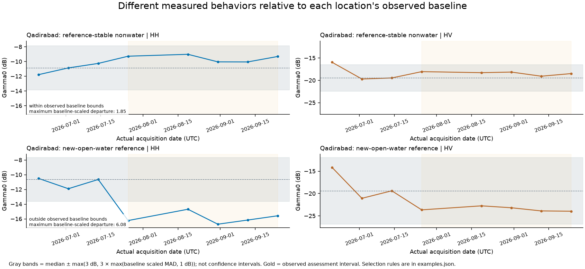
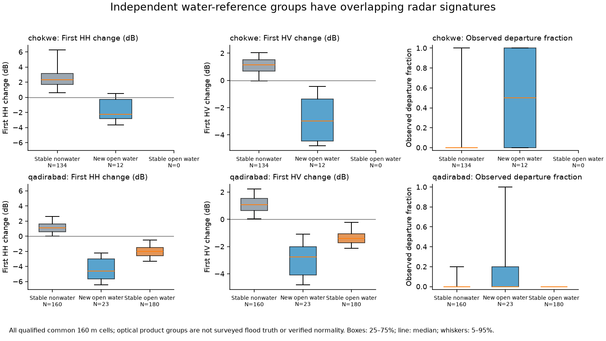

# Measured surface features and observed baseline departures

The new report makes different radar behaviors inspectable: how large a change is, whether it exceeds that location's measured baseline variability, which polarizations change, whether departures recur at observed dates, and whether a change is localized relative to surrounding cells. A separate experiment compares physical, frozen learned and combined representations using acquisition-matched histories from other regions.

**This is a baseline-departure diagnostic and an exploratory analog comparison. It does not classify verified normal conditions, floods, fires, crops, landslides or earthquakes.** No neural weights or earlier experiment thresholds are changed. All observations come from existing consumed scenes; there is no new held-out accuracy claim.



## What the measurements show

At Qadirabad, the **23 qualified new-open-water reference cells** at 160 m have a median first HH change of **−4.62 dB** and HV change of **−2.77 dB**. The **160 reference-stable predominantly nonwater cells** have median HH/HV changes of **+1.10/+1.07 dB**. The **180 stable-open-water cells** also darken: **−2.02/−1.41 dB**. Joint darkening is informative, but its magnitude and the independent water transition both matter.

Matching new-water cells to controls using only pre-assessment HH/HV levels gives a **−5.66 dB HH mean contrast** and **−4.42 dB HV mean contrast** on the matched subset. These numbers use the new common 160 m population; they must not be substituted for earlier 40 m results. Conditional spatial block-resampling intervals and their support are in `summary.json`. They omit reference errors, measurement errors and causal confounding.



The baseline diagnostic does not flag every independently referenced water change: at Qadirabad, **9 of 23 new-water cells** exceed the first-date bounds, compared with **3 of 160 stable-nonwater cells** and **0 of 180 stable-water cells**. At Chókwè, the corresponding new-water/stable-nonwater counts are **6/12** and **22/134**. These are departure fractions conditional on imperfect optical product groups, not flood recall or globally calibrated false-alarm rates. A real phenomenon can remain within a variable baseline; a routine change can exceed a short or seasonally incomplete baseline.

Across the same **3,764 sparsely sampled histories in 21 scenes**, **2,802** stay within the diagnostic bounds at every assessment date, **770** depart at one or more dates, and **192** have insufficient baseline support. There are **3,572** diagnostically supported histories. These are correlated, scene-capped samples, not worldwide area fractions. Gimcheon supplies all 192 insufficient cases because it has only one pre-assessment acquisition.

The examples also include a nearly steady Ben Guerir history and a Wheatbelt history with a progressive late-record decline. Those are descriptions of measured behavior. Crop, harvest, irrigation and disturbance causes remain unverified. The full examples document how each history was selected; they are illustrations rather than a random performance sample.

## Which features help distinguish behavior?

| Feature | Meaning | Interpretation limit |
|---|---|---|
| First/assessment-median co- and cross-pol change, dB | Direction and size of the change relative to each cell's baseline median | Multiple physical processes can cause the same direction |
| Baseline scaled MAD, dB | Variation among baseline observations | Three or a few dates cannot establish a complete seasonal distribution |
| Baseline-scaled departure | Change divided by a baseline scale with a 1 dB floor | Dimensionless diagnostic, **not sigma, probability or calibrated confidence** |
| Departure count/fraction | How many actual assessment acquisitions exceed the bounds | Does not establish continuous duration between acquisitions |
| Cross-minus-co ratio change, dB | Change in the observed polarization balance | Derived from the same two channels; not an independent radar band |
| Largest-step concentration, 0–1 | Largest absolute co-pol step divided by total absolute observed co-pol variation | Describes concentration at sampled dates; gaps may hide changes |
| Local co-pol contrast, dB | Cell change minus the median change of the eight surrounding cells | Spatial comparison, not a causal control |
| Change in neighborhood spatial scaled MAD, dB | Change in local spatial heterogeneity | Not displacement, vegetation structure or a land-cover class by itself |

The example maps show all these views on Qadirabad and the Wheatbelt. A spatially broad change can have a large temporal departure and a small local contrast. A localized change can behave differently from its surrounding cells. Those are complementary questions.

## What “within baseline bounds” means

For each cell and named channel, use only the declared baseline measurements:

\[
m=\operatorname{median}(x_\mathrm{baseline}),\quad
s=\max\{1.4826\operatorname{median}|x-m|,\;1\ \mathrm{dB}\}.
\]

The diagnostic band is `m ± max(3 dB, 3s)`. A departure occurs when either measured channel is **strictly outside** its band. The full-history state records whether any assessment date departs; the interactive scatter's axes show first-assessment changes. Its color can therefore flag a later departure even when its first change is small.

The band is **not a 95% confidence interval**, and a factor of three does not imply a Gaussian tail probability. The scale floor prevents a nearly constant or sparsely sampled baseline from producing arbitrarily large standardized scores. At least three baseline dates are required; with fewer dates, raw changes remain visible while departure scores/fractions are null and state is `insufficient_baseline`.

A fixed common population is measured in both channels at every chosen baseline/assessment date. Unsupported cells remain masked. Baseline bands never use assessment values. The first-departure bracket starts after the last earlier observation inside the bounds, when one exists, and ends at the first observed assessment departure. No exact onset, continuous duration, forecast or physical cause is inferred.

The eight characterization cases retain their previously declared windows. The 13 global-v2 scenes use the first 60% of acquisitions as a generic historical baseline and the remainder as assessment. That generic split is not an independently verified pre-event period. The reference record can itself contain events or span a different season.

The [scikit-learn documentation](https://scikit-learn.org/stable/modules/outlier_detection.html) distinguishes outlier detection in mixed data from novelty detection using an assumed clean reference population. We have no verified clean normal population, so neither this baseline rule nor the reference-distance envelope should be presented as calibrated novelty detection.

## Physical versus learned versus combined analogs

We reuse the UMAP experiment's label-blind sampled spatial cells and IDs. No new sampling depends on behavior, optical classes or desired agreement.

The analog experiment uses exactly **six actual dates: three baseline and three assessment**. For characterization cases, take the last three baseline and first three assessment dates. For generic global scenes, take the middle six contiguous acquisitions. All six are re-encoded together with the frozen L-band HH/HV, 160 m Transformer and the same constant-trajectory control. The learned vector is its 48D controlled state at first assessment minus last baseline. This is **retrospective bidirectional context**, not a baseline-only anomaly score or a forecast. The full-window baseline diagnostic above is separate from this six-date summary.

Chókwè has only one assessment date and Gimcheon only one baseline date. Their physical histories remain available, but neither has the required analog window. The remaining **3,380 histories in 19 scenes** enter this experiment.

Every method uses the same reference bank: the nine previously trained development geographies. Scaling is fitted on those regions only, with equal total weight per scene. Query geographies, optical classes and departure labels never fit scaling or metric weights. The twelve physical coordinates are baseline co/cross levels and MADs, assessment-median co/cross changes, ratio change, boundary co-pol step, co-pol step concentration, departure fraction, assessment co-pol MAD and co-pol net change. Their recorded scale floors preserve units and prevent nearly constant coordinates from dominating.

Candidate references must be in another scene and at least **200 km** away, excluding nearby Chenab/Qadirabad transfer. The following fixed timing gates apply to every method:

- Equal acquisition count: six actual dates.
- Total span ratio ≤1.3; baseline and assessment span ratios each ≤1.5.
- Boundary acquisition-gap ratio ≤2.
- L1 distance between normalized five-gap patterns ≤0.4.
- At least three eligible reference regions.

There is no temporal interpolation or invented acquisition. These gates still do not remove season, land-cover, incidence, terrain or processing differences.

Physical and learned distances are each the RMS difference of their standardized coordinates. The combined distance is `sqrt(0.5 × physical_distance² + 0.5 × learned_distance²)`, so the 48 learned coordinates do not automatically outweigh the 12 physical coordinates. The three returned neighbors come from distinct regions. The response exposes the largest measured-feature differences and their contributions to physical squared distance. Those contributions explain the metric, not the physical cause of an event.

A scene-balanced 95th percentile of leave-own-region-out **development nearest distances** supplies a descriptive distance envelope. Only six development scenes, totaling 1,032 sampled cells, have enough timing-matched regions for that calibration. The other three still contribute to the reference scaling/bank, but cannot establish an envelope on their own sampling regime. This is not a calibrated probability or proof of a good analog.

| Method | Within development distance envelope | No close cross-region analog | Insufficient matched regions |
|---|---:|---:|---:|
| Physical | 2,298 | 122 | 960 |
| Learned | 2,157 | 263 | 960 |
| Combined | 2,235 | 185 | 960 |

The **same 2,420 queries** have enough matched reference regions for every method. More accepted queries does not establish a better model. California, Deliblato, Iceland, Murray and Ben Guerir account for the 960 insufficient comparisons. The report retains their measurements and explicit abstention.

The real analog examples show why retaining physical context matters: a learned nearest history can have a very different absolute backscatter level. The combined method changes that tradeoff; no phenomenon-label benchmark here establishes that it is better. The example legends explicitly identify references outside the development envelope.

## What this supports for the phenomena

| Theme | What can now be explored | Evidence still needed for identification |
|---|---|---|
| Floods | Joint darkening/brightening, polarization balance, repeated departures and independent water-product transitions | Temporally aligned mapped events, mixed/vegetated water assessment and reference errors |
| Agriculture | Fluctuation amplitude, concentrated steps, gradual changes and similar histories elsewhere | Independent crop/management information and suitable seasonal reference records |
| Wildfires | Radar departures and spatial heterogeneity around documented contexts | Mapped fire overlap and independent disturbance/burn evidence; vegetation disturbance alone is not fire attribution |
| Landslides | Localized scattering/heterogeneity changes and acquisition brackets | Pre-event coverage, terrain visibility and independent mapped movement; Niscemi's context does not supply these labels |
| Earthquakes | Existing separate phase/coherence and correction-readiness reports | Corrections, a verified reference and independent geodetic validation before displacement interpretation |

The existing optical DIST adapter and InSAR correction-readiness gates remain available in the [v0.5 report](CHARACTERIZATION_V05.md). Phase/coherence are not inserted into the power-trained encoder. The [NASA DSWx description](https://www.jpl.nasa.gov/go/opera/products/dswx-product-suite/) documents the independent water products and their sensor differences; optical class agreement remains imperfect reference evidence.

## Reusable worldwide input/output contract

The physical worker is `surface_dynamics.fingerprint_worker.process_fingerprint(request, output)` or:

```powershell
.venv\Scripts\python.exe -m surface_dynamics fingerprint contracts\examples\wheatbelt-fingerprint.json --output products\surface_features_worker\wheatbelt
```

Use the [request schema](../contracts/fingerprint-request.schema.json), [result schema](../contracts/fingerprint-result.schema.json) and [offline example](../contracts/examples/wheatbelt-fingerprint.json). Source can be a measured local cube or a worldwide catalog point:

```json
{
  "contract_version": "1.0",
  "request_id": "world-fingerprint",
  "source": {
    "mode": "catalog_point",
    "longitude": 117.5,
    "latitude": -31.5,
    "max_dates": 12,
    "target_posting_m": 160
  },
  "baseline": {"start_date": "2026-06-01", "end_date": "2026-08-31"},
  "assessment": {"start_date": "2026-09-01", "end_date": "2026-10-31"},
  "maximum_points": 32
}
```

Live quantitative reads use the existing environment-only Earthdata authentication. A geographic selection is optional: `{ "longitude": 117.5, "latitude": -31.5, "radius_m": 1000 }`, with radius 0–25,000 m. `maximum_points` is 0–256. Source dates are actual UTC acquisitions; baseline/assessment intervals must be ordered and nonoverlapping. The physical worker supports named HH/HV or VV/VH pairs, independently of the frozen encoder's narrower L-band HH/HV/160 m domain.

Outputs contain `status`, recorded policy, source dates/grid/polarizations, fixed-support quality, feature summaries, sampled point fingerprints and eight checksummed artifacts. Each sampled point exposes baseline levels/MADs/bounds, raw and scaled changes, counts, date brackets, polarization ratio and spatial descriptors. `normal_probability`, `phenomenon_class` and `causal_attribution` remain **null**. Empty/off-grid/unsupported populations produce `no_data`; inadequate baseline dates produce `partial` with null departure scores.

Artifacts are one NPZ array bundle and seven COGs: first co/cross change, maximum scaled departure, departure frequency, assessment ratio change, local co-pol contrast, neighborhood MAD change and baseline state. The state map uses nearest-neighbor overviews and codes **0 insufficient / 1 within bounds / 2 outside bounds**, with unsupported cells masked. NPZ arrays preserve actual dates, native x/y cell centers, EPSG and fixed masks. Co/cross arrays follow the response's named polarization order. Scores and fractions have separate units from dB.

The worker preserves the input posting; `target_posting_m` governs explicit power aggregation for catalog requests. The offline example uses native 40 m inputs, whereas the 21-scene discovery experiment uses explicit 160 m aggregation. Those populations and neighborhood footprints differ. Neighborhoods use the eight surrounding cells, require four valid neighbors, and may extend beyond a requested point selection.

The online worker returns physical diagnostics; the learned/combined experiment uses its separately frozen reference bank and six-date requirements. It is not automatically invoked by a worldwide request. No app frontend or mockup was read or changed.

## Reproduce the discovery report

Install the current source with the exploration extra and restore the existing v0.5 fixtures. Generate the earlier UMAP artifact table if it is not present, then run:

```powershell
.venv\Scripts\python.exe -m pip install -e ".[exploration]"
.venv\Scripts\python.exe scripts\download_examples.py
.venv\Scripts\python.exe scripts\explore_representations.py
.venv\Scripts\python.exe scripts\characterize_surface_features.py
.venv\Scripts\python.exe scripts\verify_surface_features.py
.venv\Scripts\python.exe -m unittest discover -s tests -v
```

`products/surface_features` contains `feature_explorer.html`, baseline/analog examples, independent-reference distributions, Qadirabad/Wheatbelt maps, per-scene NPZ maps, `points.json`, `point_features.csv`, `analog_features.npz`, `analog_metadata.json`, `analogs.json`, scaling/calibration files, admission/summary reports, source freezes, reference provenance and artifact hashes. The HTML includes its data and Plotly; it requires no CDN or application frontend. Click points to inspect actual measured histories and baseline bands. `--render-only` redraws saved results without refitting.

`points.json` has all 3,764 original spatial IDs and full-window fingerprints. `analog_index` is null for incompatible histories; otherwise it indexes the same row in `analog_features.npz`, `analog_metadata.json` and `analogs.json`. The NPZ physical array is `[3380,12]`, learned array `[3380,48]`, and measured analog histories `[3380,6,2]`. Each analog metadata record contains all six UTC dates and timing diagnostics. Per-scene maps and reference distributions use **all fixed-support coarse cells**; their denominators differ from the sparse analog sample and are recorded separately.

The [portable source/data addendum](https://github.com/Ch0comilo/NISAR-Modeling/releases/download/v0.5.0/nisar-surface-features-2026-11-05.zip) contains the complete current source, measured inputs and generated feature report. Its [SHA256 companion](https://github.com/Ch0comilo/NISAR-Modeling/releases/download/v0.5.0/nisar-surface-features-2026-11-05.zip.sha256) checks the download. This is a post-release source snapshot, identified by commit inside the bundle; the original v0.5.0 tag/wheel and earlier bundles remain unchanged. Install this current source to obtain `fingerprint`; the original release wheel predates these additions.

## Validation

**Share with caveats.** All **91 offline tests** pass. Tests cover assessment-value isolation from baseline fitting, differing baseline variation for equal changes, unsupported/insufficient populations, irregular-date counts/brackets, ratio semantics, neighbor support, actual-date matching, geographic exclusion, scene-balanced reference-only normalization, worker schema/null guards and georeferenced artifacts.

The independent report verifier checks all 3,764 point measurements/bands/counts against sources in all 21 scenes. It independently reconstructs the 12D physical vector and re-infers one six-date learned trajectory in each of the 19 eligible scenes, recomputes reference-only weighted normalization, checks **21,780 returned analog distances/geographic/timing gates**, and verifies artifact checksums. The native 40 m Wheatbelt worker separately passes its schema and all eight artifact checksums. Earlier checkpoint/probe freezes remain unchanged.

These checks establish software/data consistency. They do not establish verified normal conditions, global generalization, phenomenon accuracy or causal interpretation. New independent, reference-qualified regions and seasonal controls remain necessary for those claims.
